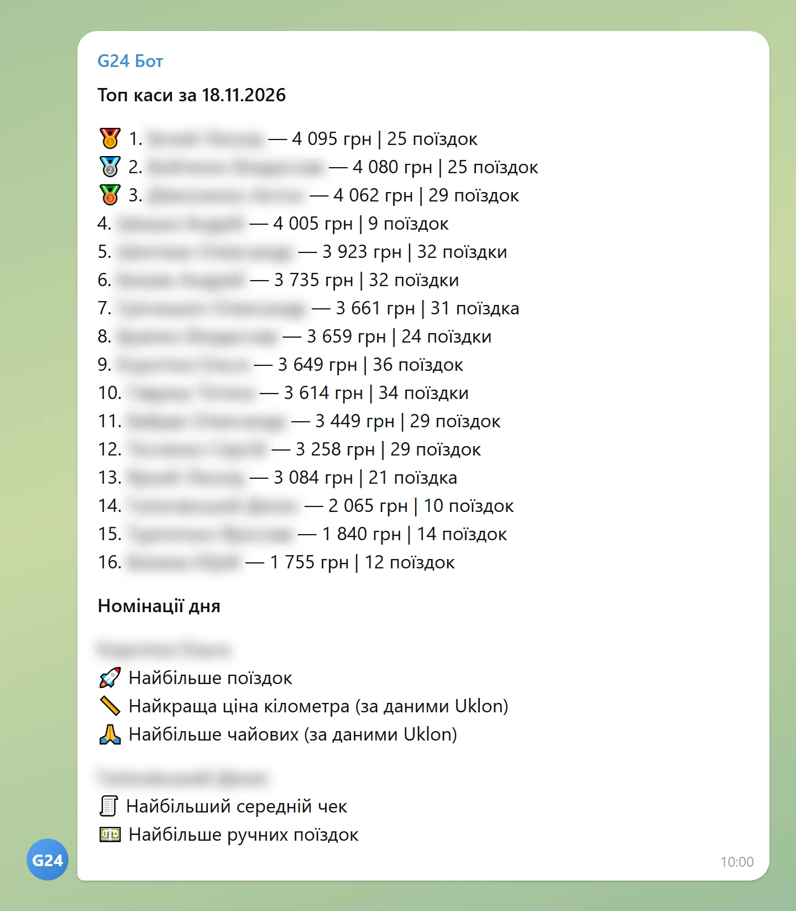

# «Топ каси»: рейтинг, який хочеться переслати в групу

Вранці менеджер парку відкриває Telegram, а там уже чекає вчорашній рейтинг водіїв. Ще у вересні ми зробили «Топ каси» для персоналу, і парки швидко знайшли йому друге життя: почали пересилати рейтинг у групу водіїв. Тільки текст для цього доводилось правити вручну. Тепер звіт одразу приходить у тому вигляді, в якому його не соромно показати водіям.



## Що змінилось

Нагорі тепер дата, за яку рахується рейтинг, і назва парку. Пересланий у групу, він не плутає: всім видно, що це вчорашній день. А менеджер, який веде кілька парків, одразу бачить, чий це рейтинг, навіть якщо частина водіїв працює в обох.

Кожен рядок рейтингу виглядає так: місце, ім'я, каса й кількість поїздок. Перші три місця з медалями. У касу й поїздки входить усе, що водій зробив за добу, і замовлення Uklon, і поїздки «на руку». Каса Uklon рахується після комісії, так само як у звіті «Заробіток водіїв», тож цифри не розходяться з рештою звітів парку.

## Номінації дня

Під рейтингом п'ять номінацій: найбільше поїздок, найкраща ціна кілометра, найбільший середній чек, найбільше ручних поїздок і найбільше чайових. Так у групі відзначають не лише лідера каси. Хтось сьогодні не перший за грошима, зате взяв найвигідніші замовлення або отримав найбільше чайових від пасажирів.

Часто одна людина забирає одразу кілька номінацій, і перелік, де її ім'я повторюється в кожному рядку, читався погано. Тому номінації тепер згруповані за водієм: ім'я один раз, під ним усе, що він виграв за день. Вище той, у кого більше нагород.

```
Ковальчук Ірина
🚀 Найбільше поїздок
📏 Найкраща ціна кілометра (за даними Uklon)
🙏 Найбільше чайових (за даними Uklon)

Мельник Олег
🧾 Найбільший середній чек
```

У номінаціях свідомо немає цифр, лише імена. Ми вирішили, що так нікому не буде прикро: переможця видно, а як далеко від нього решта, обговорювати в групі не обов'язково. Ціна кілометра й середній чек рахуються лише серед водіїв, які зробили хоча б 10 поїздок, щоб номінацію не забирала одна випадкова дорога поїздка. Якщо результат однаковий у кількох водіїв, номінація показується один раз, а над нею імена всіх, хто її розділив.

Дві номінації позначені «за даними Uklon». Чайові бувають тільки в замовленнях Uklon, а ціну кілометра ми рахуємо лише за кілометрами й касою Uklon: у ручних поїздках відстань часто не вказують, і змішані дані завищували б ціну тим, хто багато їздить «на руку». Позначка чесно каже, звідки цифра, і водій з ручними поїздками не почувається обділеним.

## Кілька парків одним звітом

Деякі наші клієнти ведуть одразу кілька парків, і водії в них частково ті самі. Раніше такий менеджер отримував окремий рейтинг по кожному парку, а людина, що вчора працювала в обох, потрапляла в кожен зі своєю половиною каси. Переслати в групу такий рейтинг було неможливо.

Тепер у Профілі на вкладці «Розсилки» є секція «Розсилки по кількох парках». Її бачать лише ті, хто має доступ до двох і більше парків. Позначте галочками парки, увімкніть Telegram чи Email, і щоранку о 10:00 прийде один спільний рейтинг. Водій, що працював у кількох парках, у ньому одним рядком: каса, поїздки й чайові складаються. Номінації рахуються за тими самими правилами, вже по всіх вибраних парках разом.

Назв парків у спільному звіті немає. Його пересилають водіям, а їм не важливо, через який парк ішли замовлення: кожен знайде себе за іменем. До звіту потрапляють лише парки, до яких у вас є доступ, тож чужих даних у ньому бути не може.

## Як отримувати

Рейтинг приходить щодня о 10:00 від бота вашого парку в особисті повідомлення. Щоб його отримувати:

1. У кабінеті відкрийте Профіль → Telegram і підключіть Telegram за посиланням або QR-кодом.
2. На вкладці «Розсилки» біля «Топ каси» увімкніть Telegram. Для спільного рейтингу по кількох парках зробіть те саме в секції «Розсилки по кількох парках» і позначте парки.
3. Збережіть налаштування й натисніть «Надіслати», щоб одразу побачити рейтинг за вчора.

Якщо ваш Telegram уже був прив'язаний до іншого акаунта, наприклад тестового, бот запропонує перенести його на цей акаунт однією кнопкою. А якщо звіт не дійшов, кабінет тепер прямо про це скаже, замість «надіслано».
