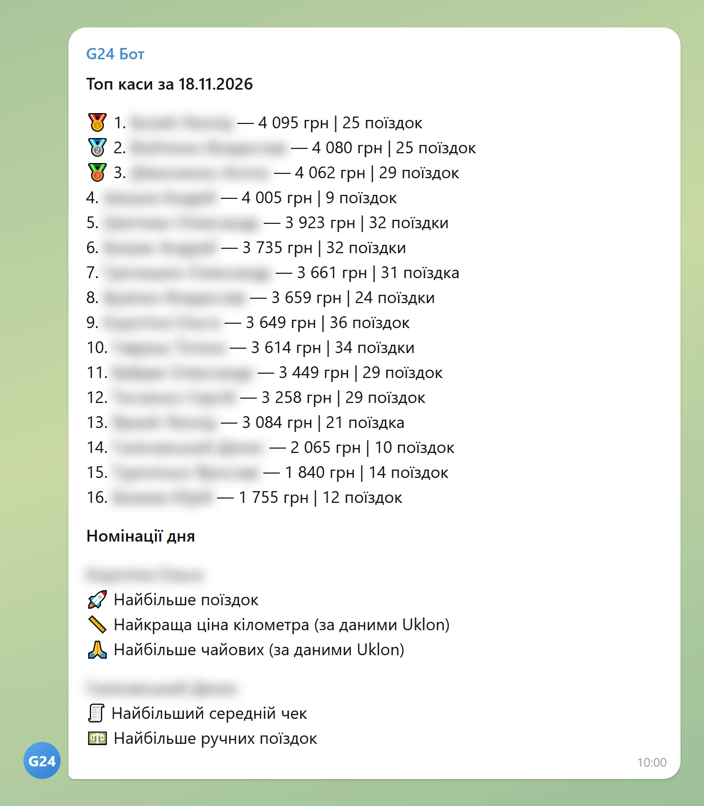

# "Top cash": a ranking you'll want to forward to the group

In the morning a fleet manager opens Telegram, and yesterday's driver ranking is already waiting. We built "Top cash" for fleet staff back in September, and fleets quickly found it a second life: they started forwarding the ranking to the drivers' group. The text had to be edited by hand first, though. Now the report arrives ready to be shown to drivers as it is.



The report itself is in Ukrainian: the bot sends it the same way to every fleet.

## What changed

The top of the report now shows the date the ranking is for and the fleet name. Once forwarded to the group, it can't be mistaken: everyone sees it's yesterday. And a manager who runs several fleets immediately sees whose ranking it is, even when some drivers work in both.

Each ranking line shows the place, the name, the cash and the number of trips. The top three get medals. Cash and trips include everything the driver did that day, both Uklon orders and cash-in-hand trips. Uklon cash is counted after the Uklon commission, just like in the "Driver earnings" report, so the numbers match the rest of the fleet's reports.

## Nominations of the day

Below the ranking there are five nominations: most trips, best price per kilometer, highest average fare, most cash-in-hand trips and most tips. This way the group celebrates more than the cash leader. Someone may not be first by money today but took the most profitable orders or got the most tips from passengers.

One person often wins several nominations at once, and a list repeating their name on every line was hard to read. So nominations are now grouped by driver: the name once, and everything they won that day below it. Whoever has more awards comes first.

```
Ковальчук Ірина
🚀 Найбільше поїздок
📏 Найкраща ціна кілометра (за даними Uklon)
🙏 Найбільше чайових (за даними Uklon)

Мельник Олег
🧾 Найбільший середній чек
```

The nominations deliberately have no numbers, only names. We decided this way nobody gets upset: the winner is visible, and how far behind the others are doesn't need to be discussed in the group. Price per kilometer and average fare only count drivers with at least 10 trips, so a single lucky expensive ride can't take the nomination. If several drivers have the same result, all of them get the nomination.

Two nominations are marked "based on Uklon data". Tips only come with Uklon orders, and we calculate the price per kilometer from Uklon kilometers and Uklon cash only: distance is often left out of cash-in-hand trips, and mixing the data would inflate the price for drivers who do many of them. The mark says honestly where the number comes from, so a driver with lots of cash-in-hand trips doesn't feel shortchanged.

## Several fleets in one report

Some of our clients run several fleets at once, and partly with the same drivers. Such a manager used to get a separate ranking for every fleet, and a person who worked in both yesterday showed up in each one with half of their cash. A ranking like that couldn't be forwarded to the group.

Now Profile has a "Mailings for several fleets" section on the "Mailings" tab. Only people with access to two or more fleets see it. Tick the fleets, turn on Telegram or Email, and one combined ranking arrives every morning at 10:00. A driver who worked in several fleets takes a single line in it: cash, trips and tips are added up. Nominations follow the same rules, now across all the chosen fleets together.

The combined report has no fleet names. It gets forwarded to drivers, and they don't care which fleet the orders went through: everyone finds themselves by name. Only fleets you have access to are included, so it can't contain anyone else's data.

## How to get it

The ranking arrives every day at 10:00 from your fleet's bot as a private message. To get it:

1. In the dashboard, open Profile → Telegram and connect Telegram using the link or the QR code.
2. On the "Mailings" tab, turn on Telegram next to "Top cash". For the combined ranking across several fleets, do the same in the "Mailings for several fleets" section and tick the fleets.
3. Save the settings and press "Send" to see yesterday's ranking right away.

If your Telegram was already linked to another account, a test one for example, the bot offers to move it to this account with one button. And if the report doesn't get through, the dashboard now says so plainly instead of "sent".
