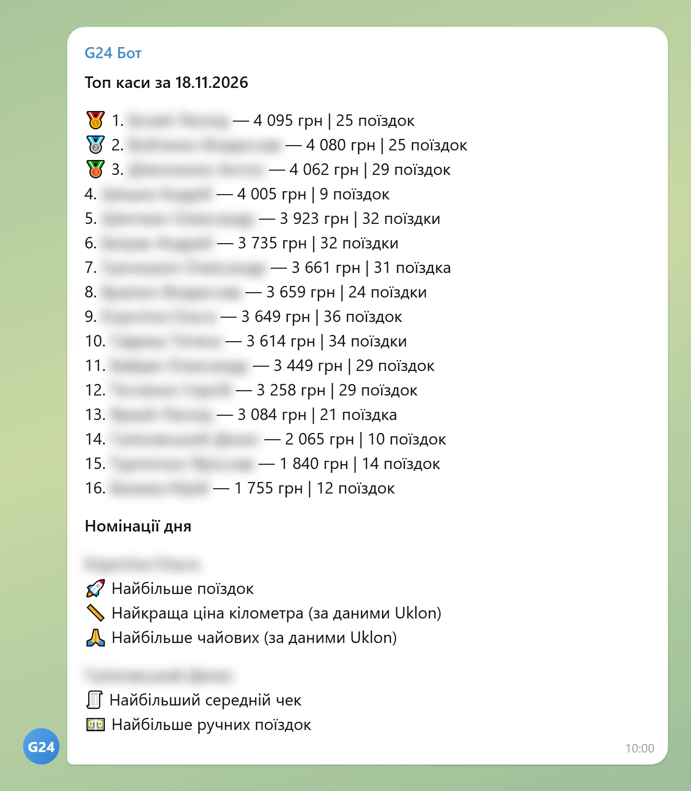

# «Топ кассы»: рейтинг, который хочется переслать в группу

Утром менеджер парка открывает Telegram, а там уже ждёт вчерашний рейтинг водителей. Ещё в сентябре мы сделали «Топ кассы» для персонала, и парки быстро нашли ему вторую жизнь: начали пересылать рейтинг в группу водителей. Только текст для этого приходилось править вручную. Теперь отчёт сразу приходит в том виде, в котором его не стыдно показать водителям.



Сам отчёт приходит на украинском: бот присылает его одинаково всем паркам.

## Что изменилось

Вверху теперь дата, за которую считается рейтинг, и название парка. Пересланный в группу, он не путает: всем видно, что это вчерашний день. А менеджер, который ведёт несколько парков, сразу видит, чей это рейтинг, даже если часть водителей работает в обоих.

Каждая строка рейтинга выглядит так: место, имя, касса и количество поездок. Первые три места с медалями. В кассу и поездки входит всё, что водитель сделал за сутки, и заказы Uklon, и поездки «на руку». Касса Uklon считается после комиссии, так же как в отчёте «Заработок водителей», поэтому цифры не расходятся с остальными отчётами парка.

## Номинации дня

Под рейтингом пять номинаций: больше всего поездок, лучшая цена километра, самый большой средний чек, больше всего ручных поездок и больше всего чаевых. Так в группе отмечают не только лидера кассы. Кто-то сегодня не первый по деньгам, зато взял самые выгодные заказы или получил больше всего чаевых от пассажиров.

Часто один человек забирает сразу несколько номинаций, и список, где его имя повторяется в каждой строке, читался плохо. Поэтому номинации теперь сгруппированы по водителю: имя один раз, под ним всё, что он выиграл за день. Выше тот, у кого больше наград.

```
Ковальчук Ірина
🚀 Найбільше поїздок
📏 Найкраща ціна кілометра (за даними Uklon)
🙏 Найбільше чайових (за даними Uklon)

Мельник Олег
🧾 Найбільший середній чек
```

В номинациях сознательно нет цифр, только имена. Мы решили, что так никому не будет обидно: победителя видно, а насколько от него отстают остальные, обсуждать в группе не обязательно. Цена километра и средний чек считаются только среди водителей, сделавших хотя бы 10 поездок, чтобы номинацию не забирала одна случайная дорогая поездка. Если результат одинаковый у нескольких водителей, номинацию получают все.

Две номинации помечены «по данным Uklon». Чаевые бывают только в заказах Uklon, а цену километра мы считаем только по километрам и кассе Uklon: в ручных поездках расстояние часто не указывают, и смешанные данные завышали бы цену тем, кто много ездит «на руку». Пометка честно говорит, откуда цифра, и водитель с ручными поездками не чувствует себя обделённым.

## Несколько парков одним отчётом

Некоторые наши клиенты ведут сразу несколько парков, и водители в них частично те же. Раньше такой менеджер получал отдельный рейтинг по каждому парку, а человек, который вчера работал в обоих, попадал в каждый со своей половиной кассы. Переслать такой рейтинг в группу было невозможно.

Теперь в Профиле на вкладке «Рассылки» есть раздел «Рассылки по нескольким паркам». Его видят только те, у кого есть доступ к двум и более паркам. Отметьте галочками парки, включите Telegram или Email, и каждое утро в 10:00 придёт один общий рейтинг. Водитель, работавший в нескольких парках, в нём одной строкой: касса, поездки и чаевые складываются. Номинации считаются по тем же правилам, уже по всем выбранным паркам вместе.

Названий парков в общем отчёте нет. Его пересылают водителям, а им не важно, через какой парк шли заказы: каждый найдёт себя по имени. В отчёт попадают только парки, к которым у вас есть доступ, поэтому чужих данных в нём быть не может.

## Как получать

Рейтинг приходит каждый день в 10:00 от бота вашего парка в личные сообщения. Чтобы его получать:

1. В кабинете откройте Профиль → Telegram и подключите Telegram по ссылке или QR-коду.
2. На вкладке «Рассылки» рядом с «Топ кассы» включите Telegram. Для общего рейтинга по нескольким паркам сделайте то же в разделе «Рассылки по нескольким паркам» и отметьте парки.
3. Сохраните настройки и нажмите «Отправить», чтобы сразу увидеть рейтинг за вчера.

Если ваш Telegram уже был привязан к другому аккаунту, например тестовому, бот предложит перенести его на этот аккаунт одной кнопкой. А если отчёт не дошёл, кабинет теперь прямо об этом скажет, вместо «отправлено».
