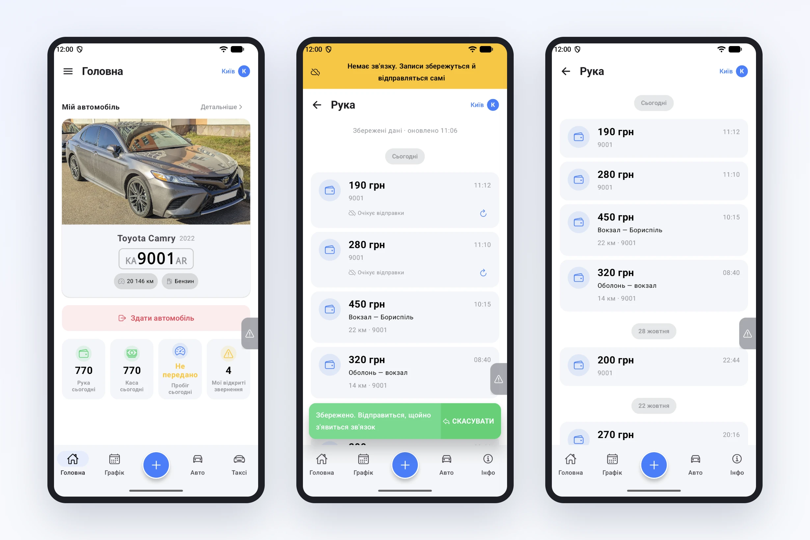
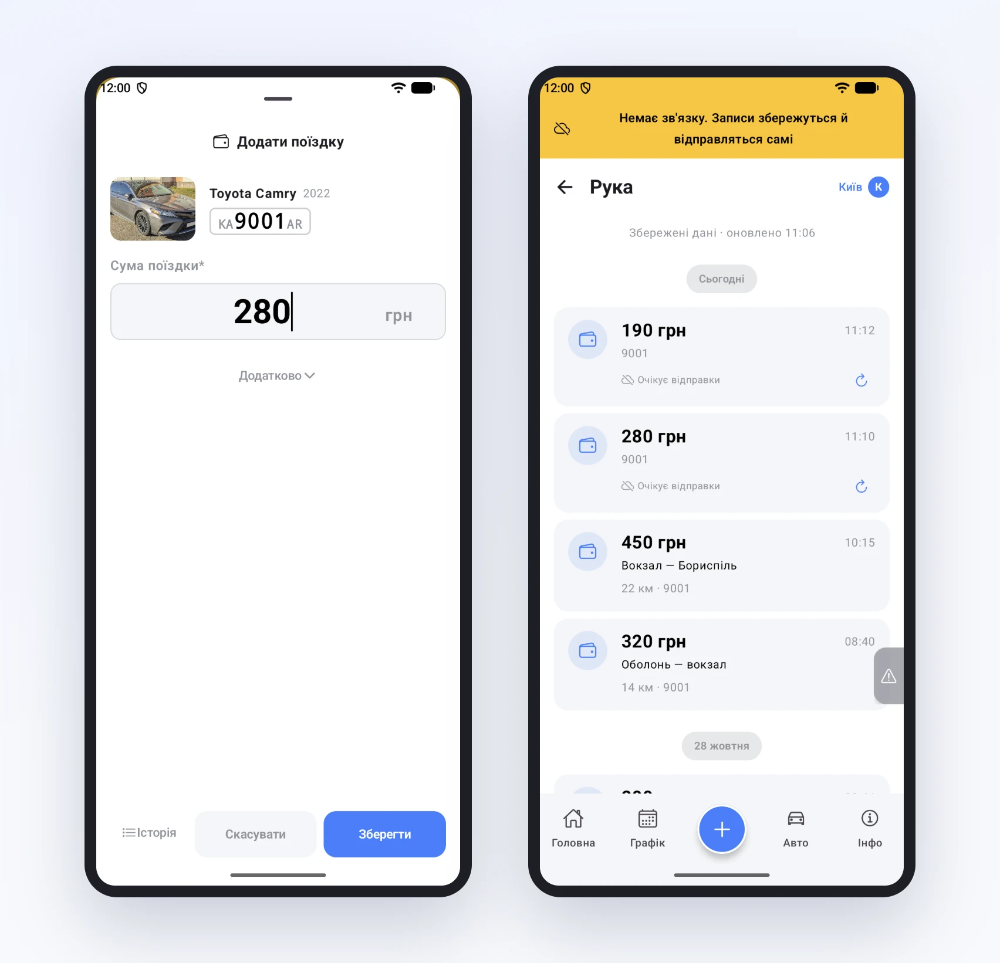

# Новий застосунок водія 2.0

Водій працює в дорозі, а дорога — це підземні паркінги, заміські траси й «мертві зони» зв'язку. Застосунок, який у такі моменти показує помилку й просить «спробувати ще раз», водій швидко закриває — і записує поїздку на папірці або не записує взагалі. Тому ми переписали застосунок водія з нуля.

## Нативно для Android та iOS

Нова версія — нативний застосунок для обох платформ, а не сайт у рамці. Екрани відкриваються одразу, без завантаження: застосунок тримає свої дані в телефоні й лише підтягує зміни з сервера. Водії отримали нову версію звичайним оновленням — нічого перевстановлювати чи заново входити не довелось.

## Без зв'язку — нічого не губиться

Поїздки, пробіг, звернення, витрати й заправки тепер можна вносити **без інтернету**. Запис зберігається в телефоні з позначкою «Очікує відправки» і йде на сервер сам, щойно з'являється зв'язок. Водієві не треба нічого пам'ятати чи натискати вдруге.

Так само без інтернету можна виправити чи видалити запис — зміна теж дочекається мережі.

## «Скасувати» — кілька секунд на роздуми

Після збереження внизу з'являється повідомлення з кнопкою **«Скасувати»**. Помилився з сумою чи натиснув не те — одне торкання, і запис не піде ні в кабінет, ні в Telegram-канал парку. Те саме — після зміни чи видалення.

## Якщо сервер не прийняв запис — це видно

Буває, що запис не проходить перевірку: наприклад, авто вже здано. Раніше водій міг цього не помітити. Тепер такий запис позначений у списку, тап по ньому пояснює причину, а поруч — «Відправити повторно» чи «Видалити». А на Головній висить нагадування, доки водій не розбереться.

## Зміни з кабінету — самі

Якщо менеджер виправив поїздку чи погодив витрату в кабінеті, водій побачить це в застосунку без оновлення сторінки: сервер сам повідомляє телефону, що є зміни.

## Що це дає парку

- Записи з дороги не губляться — навіть там, де немає зв'язку.
- Менше помилкових записів: «Скасувати» прибирає їх ще до відправки.
- Менше дзвінків «у мене не зберігається» — водій бачить стан кожного запису.
- Дані в кабінеті й у водія однакові без жодних ручних оновлень.
