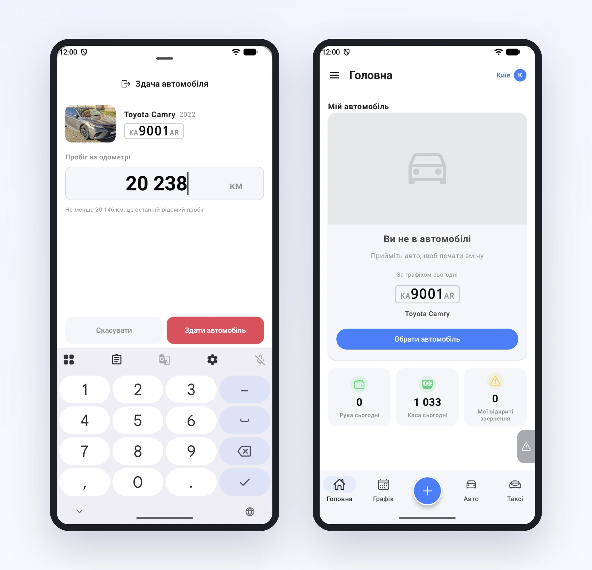
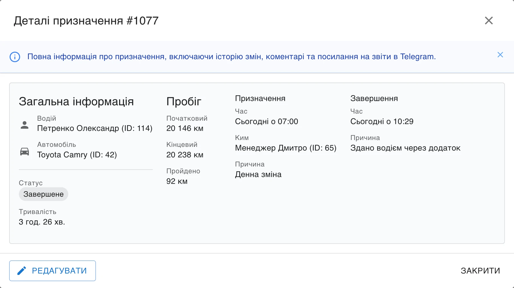

# Кінець зміни: здати авто правильно

Початок зміни зазвичай запам'ятовують усі. А от кінець часто розмитий: водій поставив машину під офісом, ключі віддав, а в системі він досі на ній. Ввечері менеджер не може посадити на авто нічного водія, бо воно «зайняте». Наступного дня ніхто не пам'ятає, о котрій зміна насправді скінчилась і скільки тоді було на одометрі.

Тому здача авто в застосунку така ж коротка, як прийом, про який ми писали раніше.

На головній під машиною є червона кнопка «Здати автомобіль». Вона відкриває форму з фото й номером авто і полем «Пробіг на одометрі». У полі вже стоїть останній відомий пробіг машини, тож водій зазвичай дописує лише останні цифри. Менше, ніж машина вже проїхала, ввести не вийде: підказка під полем стане червоною, а кнопка не натиснеться.

Після «Здати автомобіль» внизу на кілька секунд з'являється «Автомобіль здано» з кнопкою «Скасувати». Натиснув не ту машину чи помилився в цифрах? Є час передумати. Далі головна показує «Ви не в автомобілі» і нагадує, яка машина в нього сьогодні за графіком.

## Що бачить парк

Машина звільняється одразу. Інший водій уже бачить її серед вільних з новим пробігом і може прийняти, а менеджеру не треба нікого відв'язувати вручну.

У кабінеті, на сторінці **Водії → Призначення**, зміна закривається сама. У картці видно, коли водій прийняв і коли здав авто, пробіг на початку і в кінці та різницю між ними. Наприклад, Петренко в суботу взяв Camry о 07:00 на 20 146 км і здав о 10:29 на 20 238 км: 92 кілометри за 3 години 26 хвилин.

Пробіг зі здачі потрапляє і в історію пробігу авто, поруч з показами, які водії передають протягом дня. Тож якщо через тиждень постане питання «хто накатав зайві 200 км», відповідь буде з точністю до зміни.

Поки готували цю статтю, ми помітили, що здача із застосунку записувалась у систему не так, як здача з кабінету чи через Telegram: без підсумку кілометрів і без запису в історії пробігу. Тепер усі три способи працюють однаково. Заодно сервер перестав приймати очевидні помилки на кшталт зайвого нуля: стрибок більше ніж на 5000 км за раз він не прийме, як і в кабінеті.
