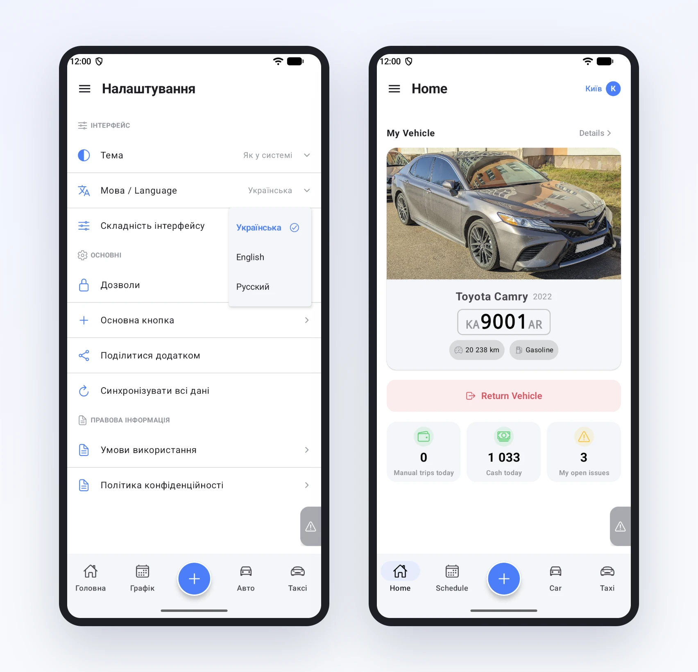
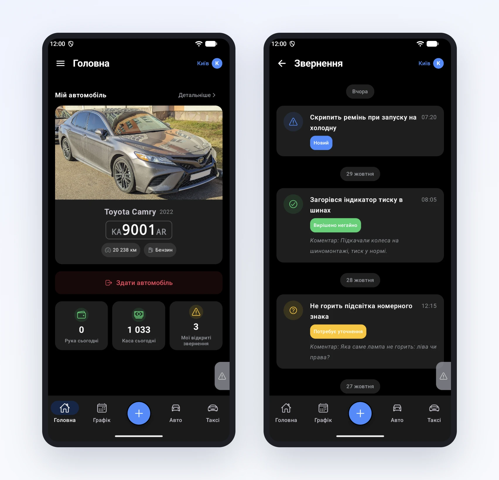

# Застосунок мовою водія, і вдень, і вночі

Водії в парку різні. Хтось читає українською, хтось краще розуміє англійську. Хтось працює вдень, а хтось виходить на нічну зміну, і яскравий білий екран о третій ночі б'є в очі. Застосунок водія Garage24 підлаштовується під обидві речі, і для цього не треба нікому дзвонити.

## Мова

Застосунок має три мови: українську, англійську й російську. Коли водій відкриває його вперше, мова береться з телефона. На телефоні з англійською застосунок буде англійською, на більшості інших українською.

Змінити її можна будь-коли в меню **Налаштування → Мова / Language**. Рядок підписаний двома мовами саме для того, щоб його знайшов і той, хто не читає українською. А назви мов у списку завжди написані самою мовою: «Українська», «English». Свою мову легко впізнати, навіть якщо зараз інтерфейс незрозумілий.

Інтерфейс перемикається одразу, без перезапуску. Головна, меню, форми, кнопки, навіть одиниці: пробіг англійською показується як «20 238 km».

Дані парку при цьому не перекладаються. Назва парку, марки авто, коментарі персоналу лишаються такими, якими їх записали.

## Тема

Поруч, у тих самих налаштуваннях, є «Тема» з трьома варіантами: «Як у системі», «Світла» і «Темна». За замовчуванням застосунок повторює тему телефона: якщо телефон увечері сам переходить на темну, застосунок теж.

Темна тема стосується всього застосунку, не лише головної. Картки звернень, статуси, плитки з рукою й касою читаються так само чітко, кольори статусів не губляться на темному тлі.

Поки готували цю статтю, ми пройшли застосунок англійською й дещо поправили: одиниці «км» і «грн» тепер теж перекладаються, а список мов відкривається під самим значенням і позначає обрану мову. Ці зміни прийдуть водіям з найближчим оновленням.
