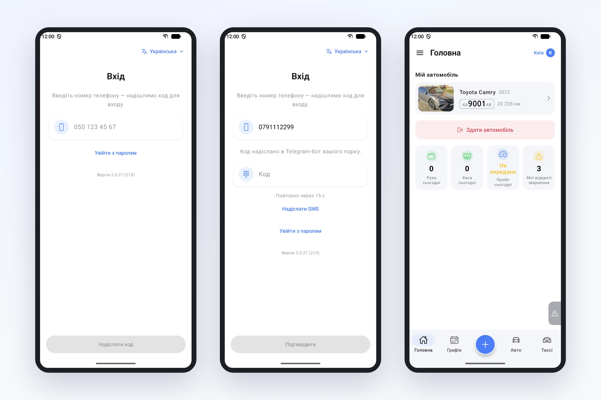
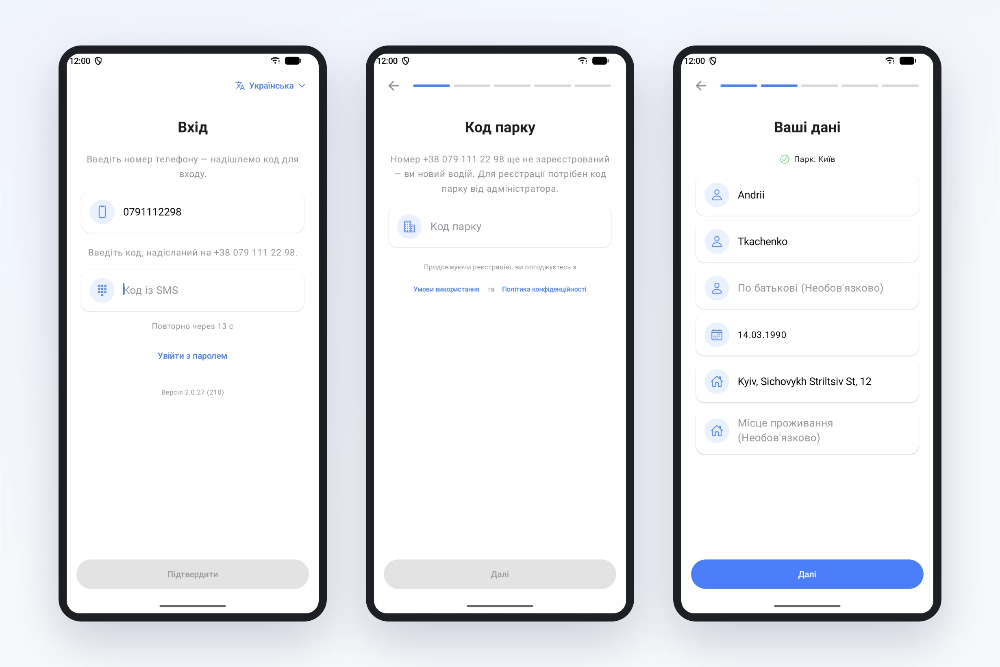

# Вхід у застосунок водія: лише номер телефону

Раніше перше питання водія після встановлення застосунку було: «а що мені натиснути?». На екрані стояли дві дороги, «Увійти» і «Зареєструватися», і водій мусив сам вирішити, яка з них його. А він часто не знав. Його вже додав диспетчер у кабінеті? Чи треба реєструватися самому?

Найгірше виходило з тими, кого парк уже додав. Такий водій натискав «Зареєструватися», проходив усі кроки, вводив ім'я, посвідчення, придумував пароль, і лише в самому кінці бачив: акаунт із цим номером уже існує. Після цього він дзвонив диспетчеру.

Ми знайшли це, коли писали для водіїв інструкцію «Як почати». Пояснити просто не виходило, бо застосунок вимагав від людини знати те, чого вона знати не може. Тож ми змінили сам вхід.

## Тепер один шлях для всіх

Водій вводить номер телефону так, як звик його писати, наприклад 050 123 45 67, і натискає «Надіслати код». Далі застосунок сам розбирається, хто перед ним.

Якщо водій уже працює в парку, після коду одразу відкривається головний екран. Без пароля, без «Забули пароль?», без реєстрації.

Якщо номера в системі ще немає, застосунок прямо пише: номер ще не зареєстрований, ви новий водій, для реєстрації потрібен код парку від адміністратора. Далі кілька кроків: код парку, ім'я й дата народження, посвідчення, email за бажанням і пароль. Пароль ми свідомо лишили: якщо колись не дійде жоден код, водій увійде з ним і не залежатиме від дзвінка диспетчеру.

## Код приходить туди, де водій уже є

SMS коштують грошей, а в деяких операторів вони приходять із затримкою або не приходять зовсім. Тому код ми спершу шлемо туди, де водія вже можна знайти:

- у Telegram-бот вашого парку, якщо водій до нього підключений;
- на пошту, якщо вона вказана в профілі;
- і лише якщо немає ні того, ні іншого, в SMS.

Застосунок пише, куди саме пішов код. Якщо в Telegram чи на пошту він не дійшов, під полем є кнопка «Надіслати SMS».

Буває, що повідомлення приходить із запізненням, а водій уже встиг натиснути «Надіслати код повторно». Тому підходить будь-який із надісланих кодів, кожен діє 15 хвилин.

## Дрібниці, які теж допомагають

Мову застосунку тепер можна обрати прямо на екрані входу, ще до реєстрації. Це для водіїв, у яких телефон налаштований не українською.

Внизу екрана входу видно версію застосунку. Коли водій дзвонить із проблемою, диспетчер одразу знає, чи оновлений у нього застосунок.

Вхід за паролем лишився для тих, хто звик: «Увійти з паролем» під полем номера.

## Що зробити парку

Нічого особливого. Водіям, яких ви додаєте в кабінеті, більше не треба задавати пароль: досить сказати «встановіть застосунок і введіть свій номер». Новим водіям, як і раніше, потрібен код парку. Його видно в кабінеті, у запрошенні водія.

Покроково для водія, з екранами, все це описано на сторінці документації [«Як почати»](/docs/driver-start). Її зручно просто переслати водієві.
