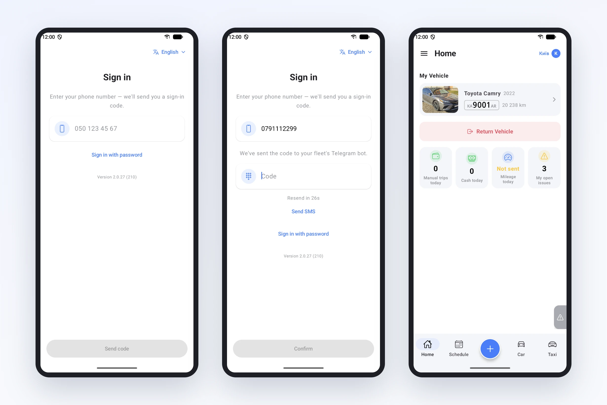
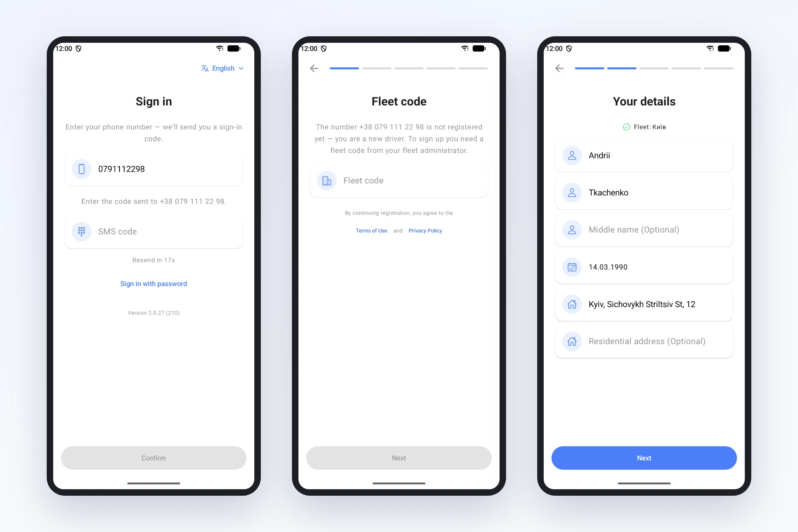

# Signing in to the driver app: just a phone number

The first question a driver used to ask after installing the app was "what do I tap?". The screen offered two paths, "Sign in" and "Sign up", and the driver had to decide which one was theirs. Often they didn't know. Had the dispatcher already added them in the fleet account? Or did they have to sign up themselves?

It went worst for drivers the fleet had already added. Such a driver tapped "Sign up", went through every step, entered their name and licence, made up a password, and only at the very end saw that an account with this number already existed. Then they called the dispatcher.

We found this while writing the "Getting started" guide for drivers. There was no simple way to explain it, because the app expected people to know something they couldn't know. So we changed the sign-in itself.

## Now there is one path for everyone

The driver enters their phone number the way they usually write it, for example 050 123 45 67, and taps "Send code". From there the app works out who it's dealing with.

If the driver already works in a fleet, the home screen opens right after the code. No password, no "Forgot password?", no sign-up.

If the number isn't in the system yet, the app says it plainly: the number is not registered, you are a new driver, and you need a fleet code from your administrator to sign up. Then come a few steps: the fleet code, name and date of birth, driver's licence, an optional email and a password. We kept the password on purpose: if a code ever fails to arrive, the driver signs in with it and doesn't depend on a call to the dispatcher.

## The code goes where the driver already is

SMS messages cost money, and with some carriers they arrive late or not at all. So we first send the code where the driver can already be reached:

- to your fleet's Telegram bot, if the driver is connected to it;
- by email, if one is in their profile;
- and only if there is neither, by SMS.

The app tells the driver where the code went, in the same language as the app. If it didn't arrive in Telegram or by email, there is a "Send SMS" button under the field.

Sometimes a message arrives late, and the driver has already tapped "Resend code". That's why any of the codes sent works, each one for 15 minutes.

## Small things that help too

The app language can now be chosen right on the sign-in screen, before signing up. This is for drivers whose phones aren't set to Ukrainian.

The app version is shown at the bottom of the sign-in screen. When a driver calls with a problem, the dispatcher knows at once whether their app is up to date.

Signing in with a password is still there for those used to it: "Sign in with password" under the phone field.

## What the fleet needs to do

Nothing special. Drivers you add in the fleet account no longer need a password from you: just tell them "install the app and enter your number". New drivers still need a fleet code, as before. You'll find it in the fleet account, in the driver invitation.

Step by step, with screens, it's all on the [Getting started](/en/docs/driver-start) documentation page. You can simply forward it to a driver.
