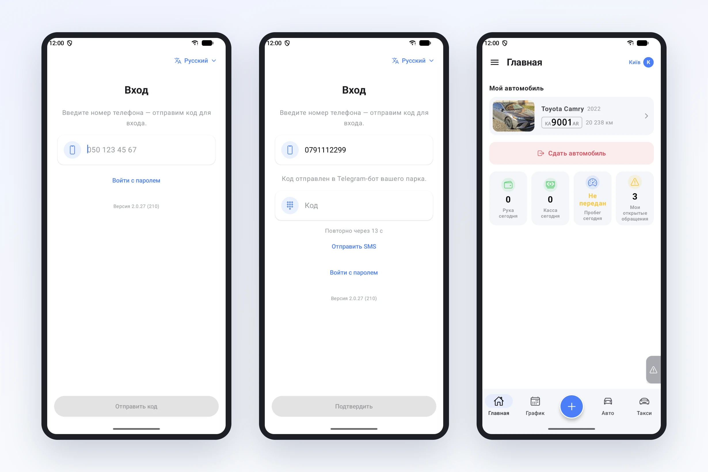
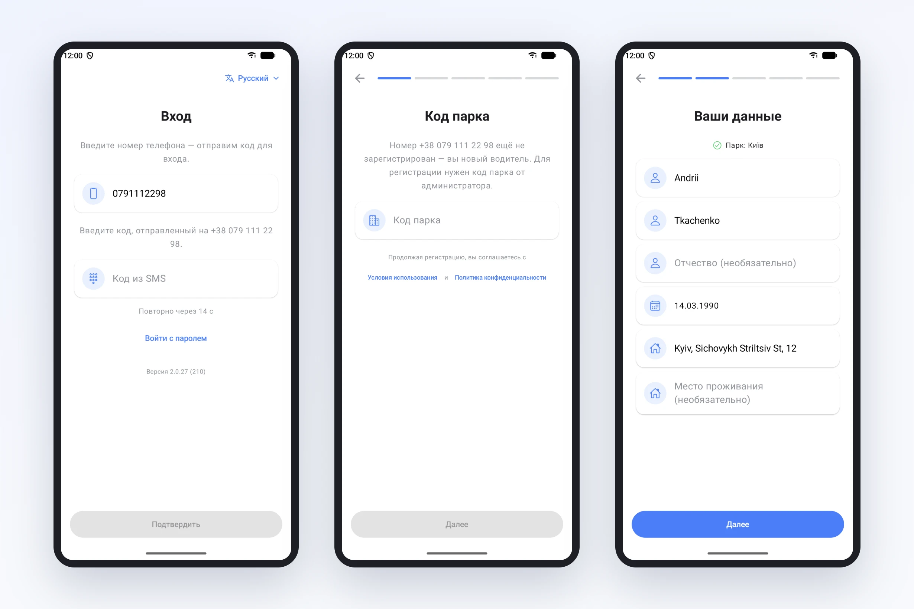

# Вход в приложение водителя: только номер телефона

Раньше первый вопрос водителя после установки приложения был: «а что мне нажать?». На экране было два пути, «Войти» и «Зарегистрироваться», и водитель должен был сам решить, какой из них его. А он часто не знал. Его уже добавил диспетчер в кабинете? Или нужно регистрироваться самому?

Хуже всего было с теми, кого парк уже добавил. Такой водитель нажимал «Зарегистрироваться», проходил все шаги, вводил имя, удостоверение, придумывал пароль и только в самом конце видел: аккаунт с этим номером уже существует. После этого он звонил диспетчеру.

Мы заметили это, когда писали для водителей инструкцию «Как начать». Просто объяснить не получалось, потому что приложение требовало от человека знать то, чего он знать не может. Поэтому мы изменили сам вход.

## Теперь один путь для всех

Водитель вводит номер телефона так, как привык его писать, например 050 123 45 67, и нажимает «Отправить код». Дальше приложение само разбирается, кто перед ним.

Если водитель уже работает в парке, после кода сразу открывается главный экран. Без пароля, без «Забыли пароль?», без регистрации.

Если номера в системе ещё нет, приложение прямо пишет: номер ещё не зарегистрирован, вы новый водитель, для регистрации нужен код парка от администратора. Дальше несколько шагов: код парка, имя и дата рождения, удостоверение, email по желанию и пароль. Пароль мы оставили намеренно: если когда-нибудь не дойдёт ни один код, водитель войдёт с ним и не будет зависеть от звонка диспетчеру.

## Код приходит туда, где водитель уже есть

SMS стоят денег, а у некоторых операторов приходят с задержкой или не приходят вовсе. Поэтому код мы сначала отправляем туда, где водителя уже можно найти:

- в Telegram-бот вашего парка, если водитель к нему подключён;
- на почту, если она указана в профиле;
- и только если нет ни того, ни другого, в SMS.

Приложение пишет, куда именно ушёл код, на том же языке, что и приложение. Если в Telegram или на почту он не дошёл, под полем есть кнопка «Отправить SMS».

Бывает, что сообщение приходит с опозданием, а водитель уже успел нажать «Отправить код повторно». Поэтому подходит любой из отправленных кодов, каждый действует 15 минут.

## Мелочи, которые тоже помогают

Язык приложения теперь можно выбрать прямо на экране входа, ещё до регистрации. Это для водителей, у которых телефон настроен не на украинский.

Внизу экрана входа видна версия приложения. Когда водитель звонит с проблемой, диспетчер сразу знает, обновлено ли у него приложение.

Вход по паролю остался для тех, кто привык: «Войти с паролем» под полем номера.

## Что сделать парку

Ничего особенного. Водителям, которых вы добавляете в кабинете, больше не нужно задавать пароль: достаточно сказать «установите приложение и введите свой номер». Новым водителям, как и раньше, нужен код парка. Его видно в кабинете, в приглашении водителя.

Пошагово для водителя, с экранами, всё это описано на странице документации [«Как начать»](/ru/docs/driver-start). Её удобно просто переслать водителю.
