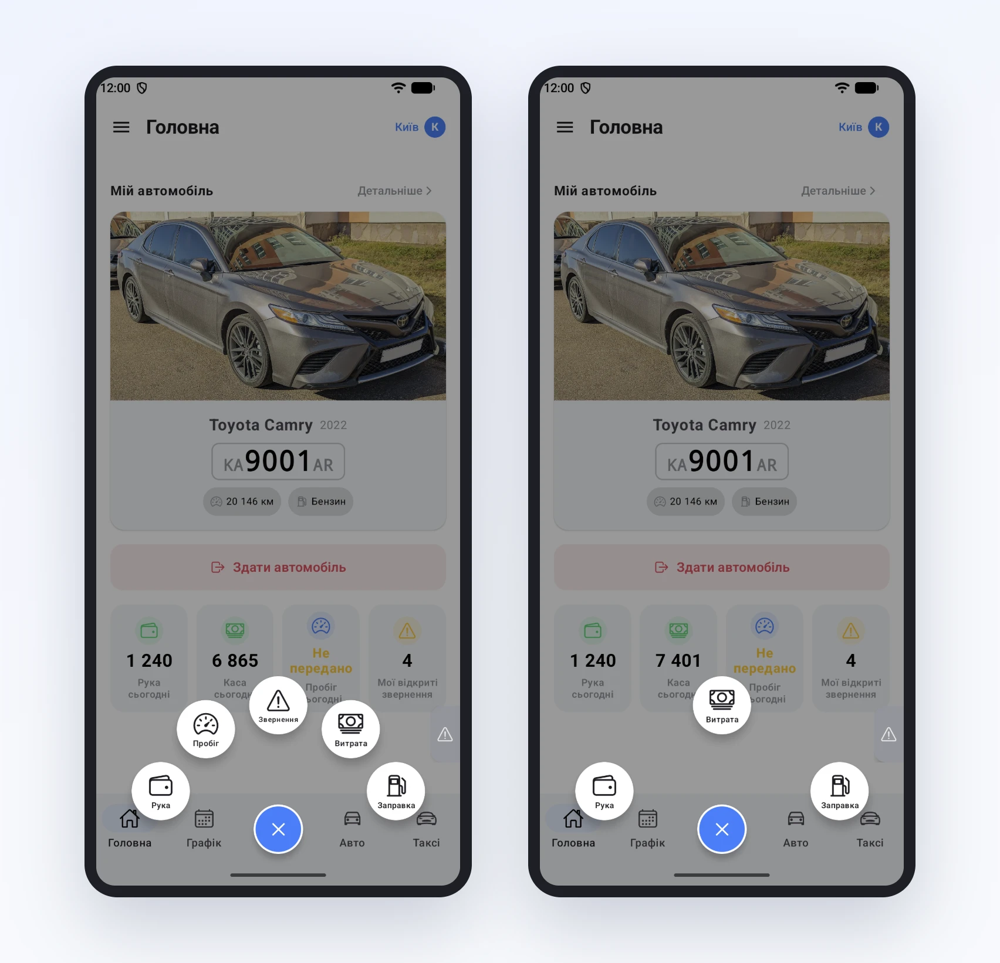
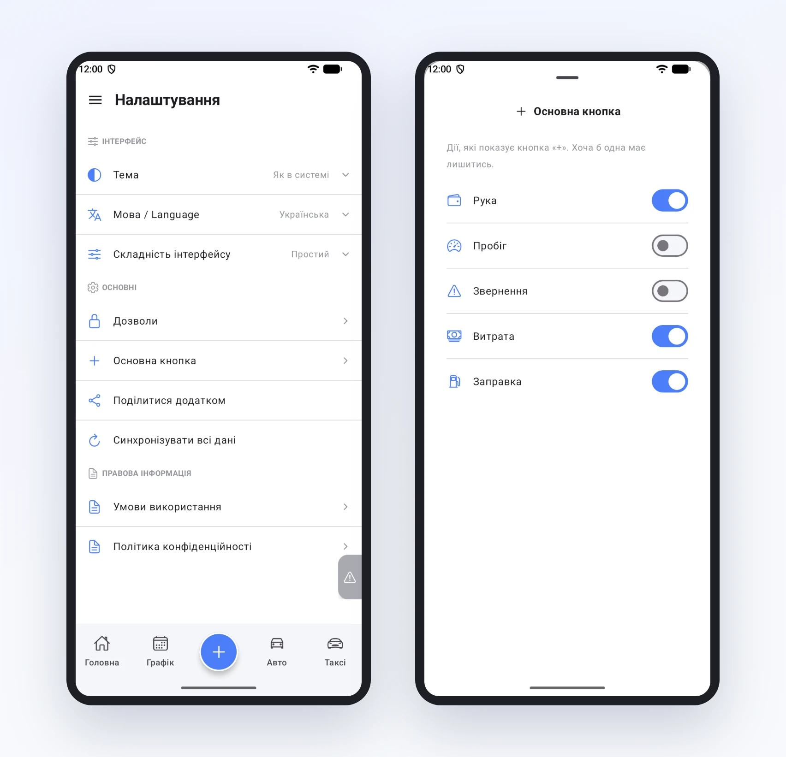

# Кнопка «+»: усе, що водій записує за зміну

Посеред зміни водій не хоче шукати, в якому розділі записати заправку. У нього пасажир, дорога і хвилина між замовленнями. Тому всі записи в застосунку починаються з одного місця: великої синьої кнопки «+» внизу екрана.

## Що всередині

Натиснули, і над кнопкою розкриваються п'ять дій:

- Рука для поїздки, за яку заплатили водію напряму;
- Пробіг, якщо парк просить передавати його протягом дня;
- Звернення про несправність;
- Витрата, наприклад мийка чи платна дорога, яку потім погодить менеджер;
- Заправка з літрами й сумою.

Кожна дія відкриває коротку форму. Зазвичай досить ввести суму чи число і натиснути «Зберегти».

## Лишити тільки потрібне

Не в кожному парку водії роблять усе. Хтось не заправляється сам, бо пальне купує парк. Хтось не передає пробіг посеред дня. Зайві кнопки тільки заважають і провокують помилкові записи.

Тому в меню є **Налаштування → Основна кнопка**. Там п'ять перемикачів, по одному на дію. Вимкнули «Пробіг» і «Звернення», і кнопка «+» показує лише руку, витрату й заправку. Одна дія мусить лишитись, інакше кнопці нічого було б показувати.

Повернути все назад можна там само, одним дотиком. Записи, зроблені раніше, від цього нікуди не зникають.
