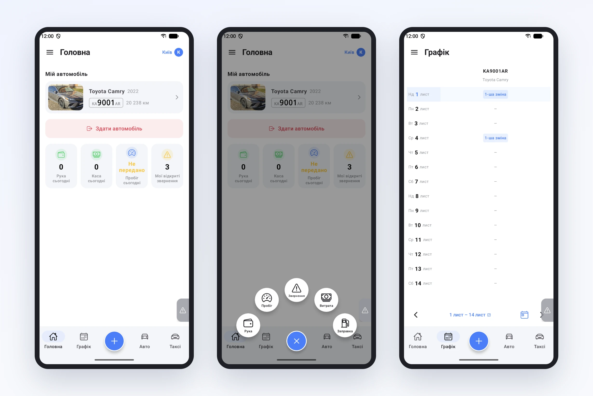
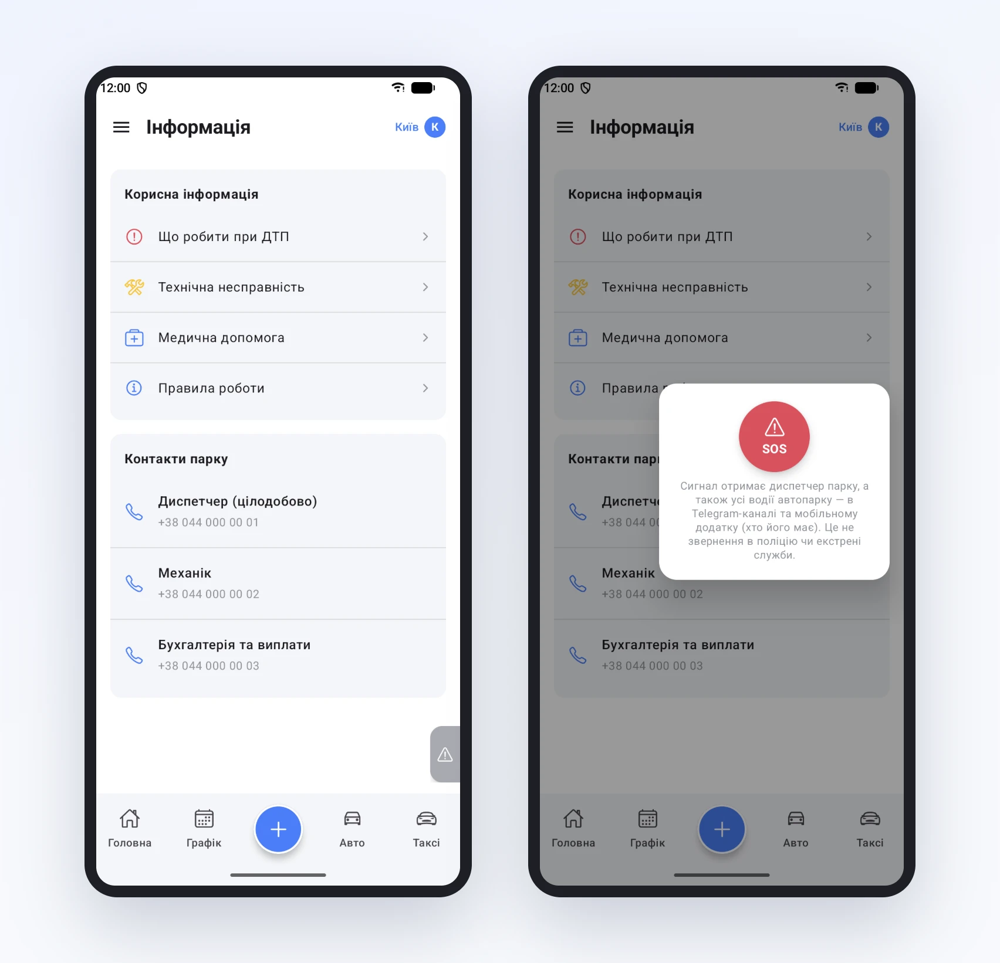

# Уся зміна водія в одному телефоні

Ми часто чуємо від парків одне й те саме: водій дзвонить диспетчеру, щоб дізнатись, коли в нього зміна, на якій машині і куди подзвонити, якщо щось трапилось. Застосунок водія Garage24 зроблений саме для того, щоб таких дзвінків ставало менше. Пройдемо зміною від початку до кінця.

## Зранку: головна

Водій відкриває застосунок і бачить своє авто з фото, номером і пробігом. Під ним чотири плитки: скільки сьогодні заробив на руках, яка каса, чи передав пробіг і скільки в нього відкритих звернень. Якщо авто ще не прийняте, на тому ж місці буде підказка, яка машина в нього за графіком.

Графік на сусідній вкладці. Два тижні наперед, по днях, з номером авто і зміною. Дзвонити й питати «коли я завтра» більше не треба.

## Посеред зміни: кнопка «+»

Велика синя кнопка внизу відкриває все, що водій записує протягом дня: поїздку на руках, пробіг, заправку, витрату чи звернення про несправність. Два дотики, і запис уже в парку. Немає зв'язку? Запис збережеться в телефоні й відправиться сам, коли мережа з'явиться.

## Якщо щось трапилось

У меню є розділ «Інфо». Там короткі інструкції, які парк пише сам: що робити при ДТП, при технічній несправності, коли потрібна медична допомога, правила роботи. Нижче контакти: диспетчер, механік, бухгалтерія. Номер набирається одним дотиком.

А для справді поганої ситуації є SOS. Невелика закладка з правого краю екрана доступна на будь-якій сторінці. Сигнал одразу отримує диспетчер і водії парку в Telegram-каналі та в застосунку. Застосунок чесно попереджає, що це не виклик поліції чи швидкої.

## Наприкінці

Зміна закінчилась, водій натискає «Здати автомобіль» на головній, підтверджує пробіг, і машина вільна для наступного. Про кожен з цих кроків ми ще розкажемо окремо в найближчих статтях.

Застосунок є в Google Play і App Store, а підключити водія можна з його картки в кабінеті.
