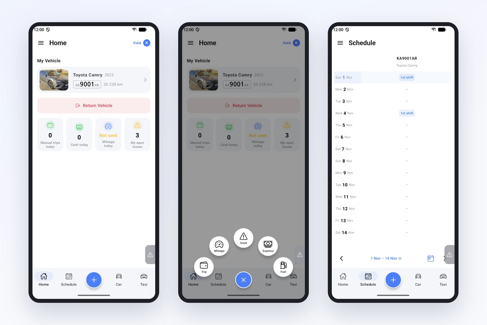
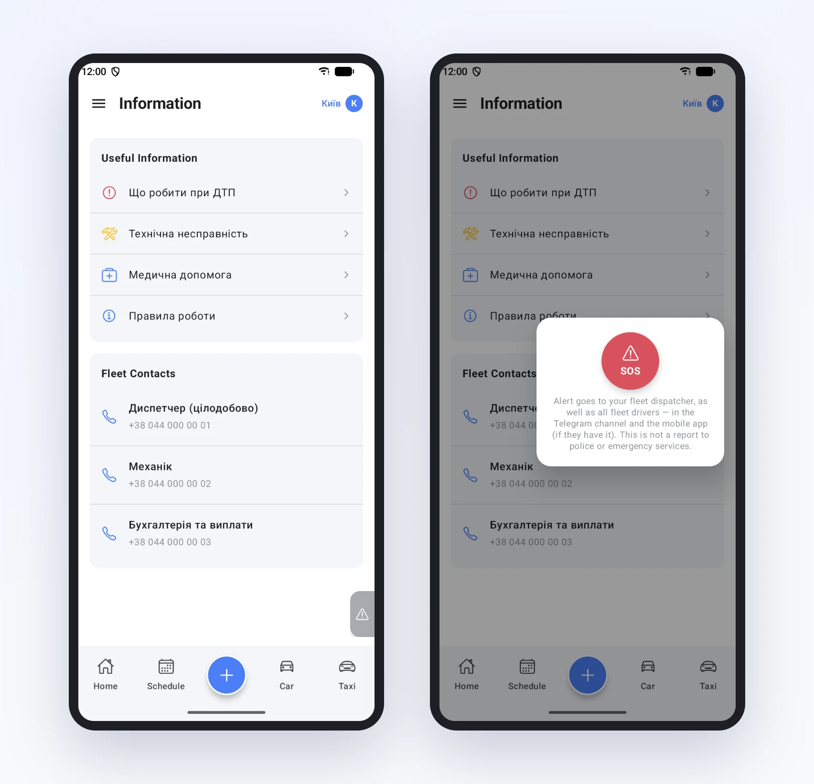

# A driver's whole shift on one phone

We keep hearing the same thing from fleets: a driver calls the dispatcher to find out when their shift is, which car they're on and who to call if something happens. The Garage24 driver app was built to make those calls rarer. Let's walk through a shift from start to finish.

## Morning: the home screen

The driver opens the app and sees their car with a photo, plate number and mileage. Below it are four tiles: today's manual trips, today's cash, whether mileage has been sent and how many open issues they have. If the car hasn't been picked up yet, the same spot shows which car is on their schedule.

The schedule is on the next tab: two weeks ahead, day by day, with the car number and the shift. No more calling to ask "when am I on tomorrow".

## Mid-shift: the "+" button

The big blue button at the bottom opens everything a driver records during the day: a manual trip, mileage, refuelling, an expense or a fault report. Two taps and the entry is already with the fleet. No signal? The entry is saved on the phone and sent automatically once the network is back.

## If something happens

The menu has an "Information" section. It holds short instructions the fleet writes itself: what to do after an accident, in case of a technical fault, when medical help is needed, work rules. Below are the contacts: dispatcher, mechanic, accounting. A number is dialled with one tap.

And for a really bad situation there is SOS. A small tab on the right edge of the screen is available on any page. The alert goes straight to the dispatcher and the fleet's drivers in the Telegram channel and in the app. The app honestly warns that this is not a call to the police or an ambulance.

## At the end

The shift is over: the driver taps "Return Vehicle" on the home screen, confirms the mileage, and the car is free for the next driver. We'll cover each of these steps separately in upcoming articles.

The app is available on Google Play and the App Store, and you can connect a driver from their card in the dashboard.
