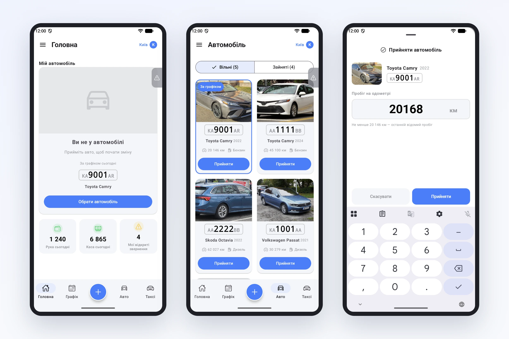
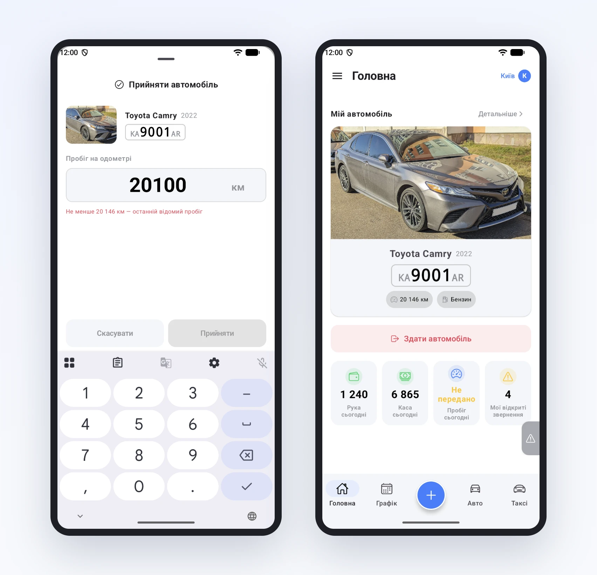

# Початок зміни: прийняти авто за хвилину

Пробіг на початку зміни потрібен парку не для галочки. Від нього рахуються витрати, ТО і суперечки «хто накатав зайві 200 км». А записувати його на папірці чи в чаті водії не люблять, і часто забувають. Тому в застосунку прийом авто і пробіг це один крок.

## Яке авто моє сьогодні

Поки водій не прийняв машину, головна показує, яка в нього за графіком: номер і модель. Кнопка «Обрати автомобіль» відкриває список вільних авто, і машина з графіка стоїть першою з позначкою «За графіком». Якщо графіка на сьогодні немає, водій обирає будь-яку вільну.

## Пробіг одразу при прийомі

Після «Прийняти» відкривається коротка форма: фото й номер машини та поле «Пробіг на одометрі». У полі вже стоїть останній відомий пробіг, курсор у кінці числа. Водію лишається дописати кілька останніх цифр з одометра і натиснути «Прийняти».

Помилитися складно. Під полем видно, менше якого пробігу ввести не можна. Якщо водій ввів 20 100 замість 20 168, підказка стає червоною, а кнопка не натискається, поки число не виправлять.

## Що бачить парк

Щойно водій прийняв авто, машина на його головній, а в кабінеті парку видно, хто на ній і з якого часу. Пробіг з прийому потрапляє в історію авто, і наприкінці зміни буде з чим порівняти.

Про здачу авто розповімо в одній з наступних статей.
