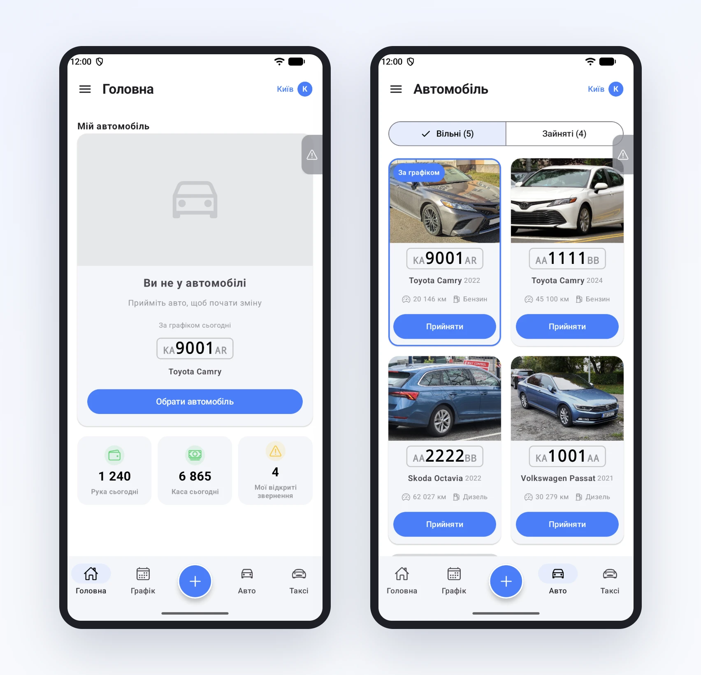
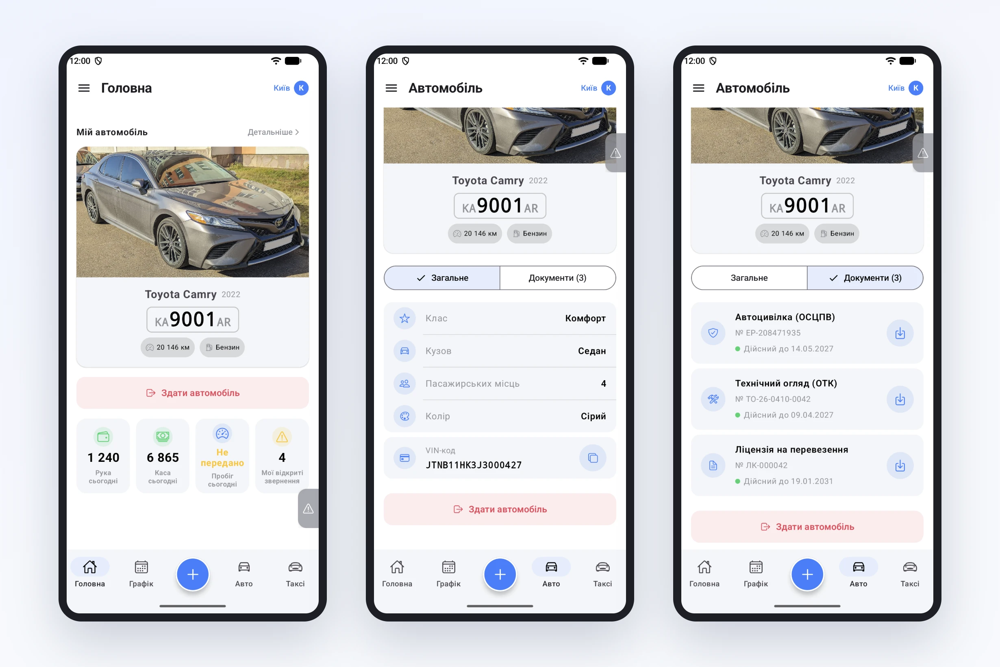

# Яке авто моє? Тепер видно з першого погляду

Ранок, стоянка парку, три сірі седани поруч. Водій відкриває застосунок, бачить у списку «Toyota Camry, KA9001AR» і йде звіряти номери. Знайома картина? Ми теж її чули, і не раз. Тому в останньому оновленні застосунку водія авто нарешті виглядають як авто.

## Список, у якому легко знайти своє

Коли водій ще не прийняв машину, головна підказує, яка з них за графіком на сьогодні. Кнопка «Обрати автомобіль» відкриває список карток: фото, великий номер, модель, пробіг і паливо. Авто з графіка стоїть першим і позначене «За графіком», тож шукати не доводиться.

Зверху дві вкладки: «Вільні» можна прийняти одразу, у «Зайнятих» машини, які вже на лінії.

Фото береться з картки авто в кабінеті парку, кнопка «Завантажити фото». Одне фото на машину, і водії більше не плутають однакові седани. Де фото немає, застосунок покаже значок авто, а номер однаково буде великим.

## Своє авто завжди перед очима

Після прийому машина займає верх головної: фото, номер, пробіг і паливо. Звідти ж її здають наприкінці зміни.

На вкладці «Авто» тепер два розділи. У «Загальному» клас, кузов, кількість місць і колір, а ще VIN. Його можна скопіювати одним дотиком, коли просять на СТО чи в страховій. У «Документах» страховка, техогляд і ліцензія з номерами й строками дії. Документ завантажується натисканням на стрілку, а якщо файлів кілька, застосунок запитає, який саме потрібен.

## Дрібниці, які теж помітні

Номер авто став більшим і читається навіть на ходу. Колір і паливо написані українською: «Сірий», «Бензин», а не Gray чи petrol. А коли водій вводить пробіг, курсор одразу стоїть у кінці числа, і під полем видно, менше якого значення ввести не можна.

Усе це є у застосунку водія з версії 2.0.21. Фото авто можна додати в кабінеті хоч зараз: водії побачать їх при наступному відкритті застосунку.
