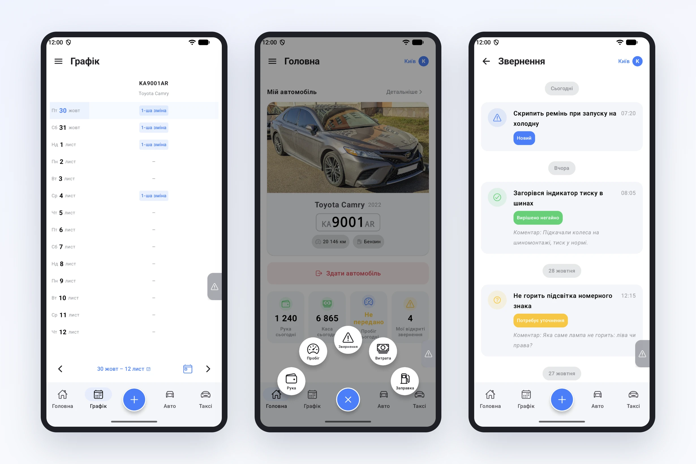

# Навіщо парку застосунок водія

За останні тижні ми розповіли про застосунок водія Garage24 майже все: прийом і здачу авто, кнопку «+», ручні поїздки, звернення, мови. Тепер подивимось на нього з іншого боку, очима власника парку. Не «що вміє застосунок», а які щоденні питання він знімає з менеджера.

Хто зараз на якій машині? Раніше це знав той, хто останнім говорив з водієм. Тепер водій сам приймає авто в телефоні на початку зміни і здає наприкінці. У кабінеті парку видно, хто на авто і з якого часу, а машина звільняється для наступного водія в ту ж хвилину, коли попередній її здав.

Скільки машина проїхала і коли їй на ТО? Пробіг водій вводить при прийомі, при здачі і просто протягом дня. Застосунок не дасть записати менше, ніж уже є на одометрі. Після зміни в кабінеті видно пробіг на початку й у кінці та скільки кілометрів проїхано, тож суперечка «хто накатав зайві 200 км» вирішується з точністю до зміни.

Які гроші водій тримає на руках? Поїздку за готівку, заправку чи іншу витрату водій записує за два дотики через кнопку «+», щойно це сталось. Немає зв'язку на заправці за містом? Запис почекає в телефоні й відправиться сам. На головній водій бачить свою руку й касу за день, тож у кінці зміни менше сюрпризів з обох боків.

Що з машиною не так? Скрипить ремінь, горить індикатор, не світить лампа: водій пише про це з телефону, поки не забув. Парк відповідає статусом і коментарем, і водій бачить відповідь у тому ж списку. Не треба дзвонити механіку, щоб дізнатись, чи хтось узагалі прочитав.

Коли в мене зміна і що робити, якщо щось трапилось? Графік на два тижні наперед у водія в кишені. Там само інструкції парку на випадок ДТП чи поломки, телефони диспетчера й механіка. Для найгіршого випадку є SOS: сигнал одразу бачать диспетчер і водії парку.

І ще дрібниці, які зберігають нерви: документи авто в телефоні, щоб показати їх на вимогу; інтерфейс українською, англійською чи російською; темна тема для нічних змін.

Жодна з цих речей сама по собі не нова. Нове те, що вони в одному місці, у телефоні, який водій і так тримає в руках усю зміну. Менше дзвінків «а де», «а скільки», «а хто», більше часу на те, щоб парк заробляв.
