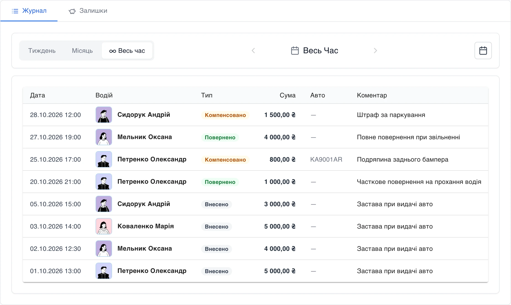
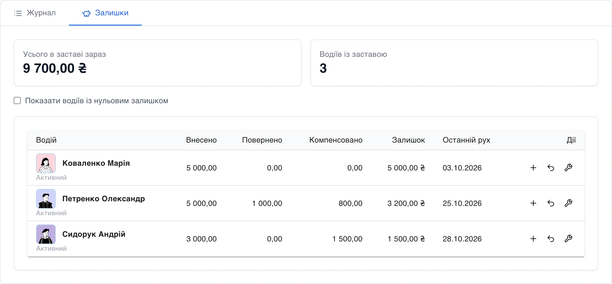

# Застави водіїв без Excel

Застава — звична практика: водій лишає парку суму, коли бере авто, а парк повертає її, коли водій іде. Але далі починаються питання. Скільки зараз застави в кожного? Чи повертали частину? З чиєї застави списали подряпину на бампері? Відповіді зазвичай живуть у таблиці, яку веде одна людина, — і розходяться з реальністю саме тоді, коли треба віддати гроші.

## Журнал: кожен рух — запис

На сторінці **Фінанси → Залоги водіїв** кожна операція — окремий запис з датою, водієм, сумою й коментарем:

- **Внесено** — водій лишив заставу;
- **Повернено** — частину або всю суму віддали водієві;
- **Компенсовано** — із застави покрили збиток: штраф, подряпину, ремонт. Можна одразу вказати авто.

## Залишки: скільки парк тримає зараз

Вкладка **«Залишки»** відповідає на головне питання: скільки грошей у заставі зараз — усього й по кожному водію. Поруч — скільки внесено, повернено й компенсовано, коли був останній рух. Додати заставу, повернути чи компенсувати витрату — кнопками прямо в рядку водія.

## Залишок ніколи не йде в мінус

Повернути чи компенсувати більше, ніж є в заставі водія, система не дасть — навіть якщо двоє менеджерів одночасно оформлюють повернення тому самому водієві. Помилка «повернули двічі» більше неможлива.

## Хто без застави — видно на Головній

На Головній кабінету — віджет **«Водії без застави»**: активні водії, нові й кандидати, які ще не вносили заставу або вже її вичерпали, з поясненням причини. Клік — і одразу форма внесення. Те саме число бачить і персонал у мобільному застосунку.

## Гроші водія — окремо від грошей парку

Застава — це гроші водія, які парк лише зберігає, тому в заробіток водія вона не потрапляє. У фінанси парку йде тільки та сума, якою компенсували збиток, — і саме як дохід парку, автоматично.

## Що це дає парку

- Одна правда про застави замість таблиці в однієї людини.
- Жодних «повернули двічі» — залишок перевіряє система.
- Збитки, покриті із застави, одразу у фінансах парку.
- Водії без застави не загубляться — вони на Головній.
