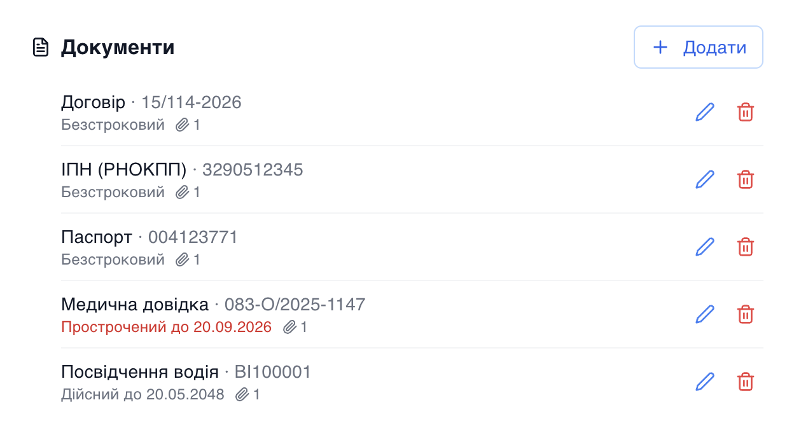
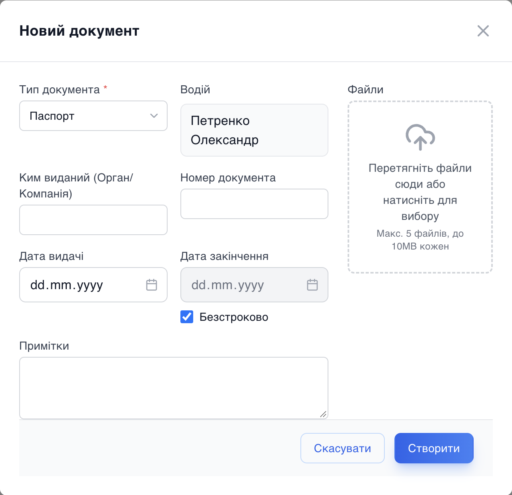

# Усі документи водія — в його картці

Коли водій приходить у парк, менеджер фотографує паспорт, посвідчення, медичну довідку, підписує договір. А далі ці фото живуть у телефоні менеджера, в чаті з водієм чи в папці на робочому столі. Коли через пів року треба звірити номер посвідчення чи знайти договір, починаються пошуки. Тепер документи водія зберігаються там само, де й уся інформація про нього, — у його картці в кабінеті.

## Що можна зберігати

Модуль «Документи» досі вів лише документи авто: страховки, техогляд, ліцензії. Тепер він працює й для водіїв:

- **Паспорт**
- **ІПН (РНОКПП)**
- **Посвідчення водія**
- **Медична довідка**
- **Договір**
- **Інше** — для всього, що не вписується в список. Таких документів можна мати скільки завгодно.

У кожного документа є номер, ким і коли виданий, термін дії та скан-копії — фото чи PDF, скільки знадобиться.

## Терміни — під контролем

Посвідчення водія й медична довідка мають термін дії, і саме вони найчастіше «тихо» прострочуються. Система показує статус кожного документа, а прострочений позначає одразу, без ручних перевірок. Паспорт, ІПН і договір за замовчуванням безстрокові, тож поле терміну не заважає, коли воно не потрібне.

Якщо водієві додати другий чинний документ того самого типу — наприклад, нове посвідчення, коли старе ще значиться активним, — система попередить, щоб у картці не було плутанини.

## Як це виглядає

У картці водія з'явилась секція **«Документи»**: тип, номер, термін дії з позначкою «прострочений» і кількість прикріплених файлів. Кнопки «Додати», «Редагувати», «Видалити» — поруч.

Форма та сама, що й для документів авто, тож переучуватися не треба. Водій уже підставлений, у списку лише водійські типи документів, а поля вартості немає — документ водія не стає витратою парку.

## Кожен парк бачить своє

Документ належить водієві в конкретному парку. Якщо та сама людина працює в кількох парках чи філіях, кожен із них бачить лише свої записи — чужі документи не «перетікають» між парками.

## Що це дає парку

- Документи водія — в одному місці з його графіком, авто й фінансами, а не в месенджері.
- Прострочене посвідчення чи медична довідка видно одразу, а не тоді, коли водія зупинили на дорозі.
- Новий менеджер чи адміністратор знаходить усе потрібне в картці, без розпитувань колег.
