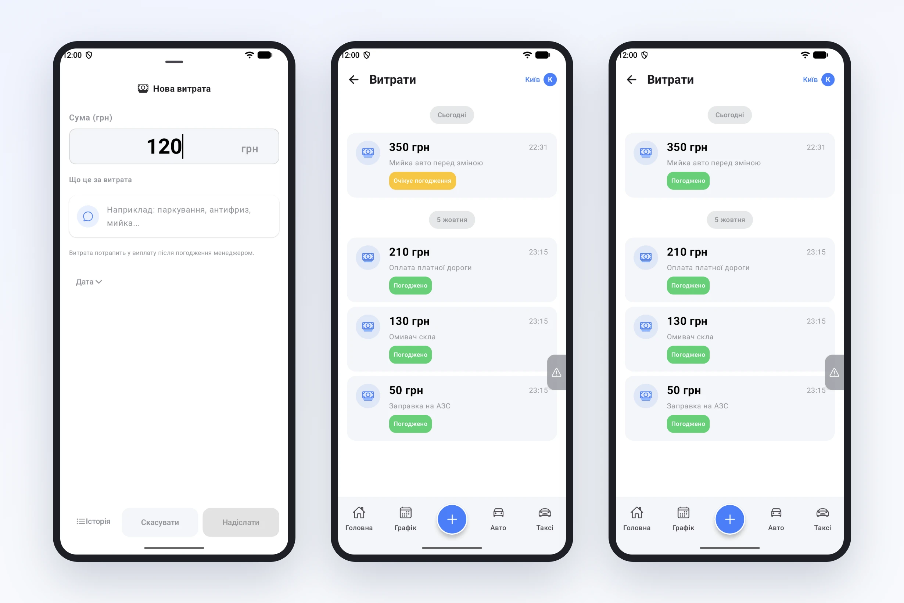
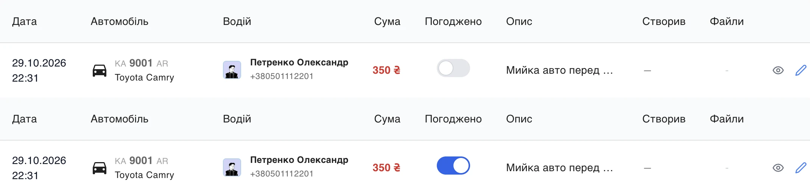

# Витрати водія — з погодженням менеджера

Водій помив авто перед зміною, заплатив за паркування чи купив омивач — і чекає, що парк поверне ці гроші. Раніше такі витрати жили в чеках, фото в месенджері й пам'яті менеджера, а під час розрахунку їх доводилось збирати по крихтах. Тепер водій вносить витрату сам, у застосунку, а менеджер вирішує, чи врахувати її у виплату.

## Водій: сума й коротко — за що

Дія **«Витрата»** є в меню кнопки «+» — і в простому режимі застосунку, з якого починає більшість водіїв. Форма — дві речі:

- **сума**;
- **що це за витрата** — «мийка», «паркування біля вокзалу», «омивач скла».

Дата й час підставляються самі, а за потреби їх можна змінити. Під формою — підказка, що витрата потрапить у виплату після погодження менеджером, тож водій одразу розуміє, як це працює.

У розділі **«Витрати»** водій бачить усі свої витрати за днями і статус кожної: **«Очікує погодження»** чи **«Погоджено»**. Поки витрату не погоджено, її можна виправити або видалити протягом доби.

## Менеджер: один клік у кабінеті

У кабінеті, в розділі **Фінанси → Витрати водіїв**, з'явилась колонка **«Погоджено»** з тумблером. Менеджер погоджує витрату або скасовує погодження одним кліком, а підказка показує, хто саме погодив. Фільтр «Погодження» залишає в списку лише витрати, які чекають рішення.

## У виплату — лише погоджене

Погоджена витрата потрапляє у звіт **«Заробіток водіїв»** — у колонку «Витрати» — і збільшує суму до виплати водієві. Витрата, яку ще не погодили, на розрахунок не впливає.

Кілька правил, щоб усе було прозоро:

- витрату, внесену персоналом у кабінеті чи в застосунку персоналу, погоджено одразу;
- погоджену витрату водій уже не може змінити чи видалити;
- усі витрати, внесені до появи погодження, позначено погодженими, тож розрахунки за минулі періоди не змінились.

## Що це дає парку

- Витрати водіїв — у системі, а не в чеках і переписці.
- Менеджер контролює, що саме парк компенсує: жодна витрата не потрапить у виплату без його рішення.
- Водій бачить статус і не мусить питати, чи врахували його витрату.
