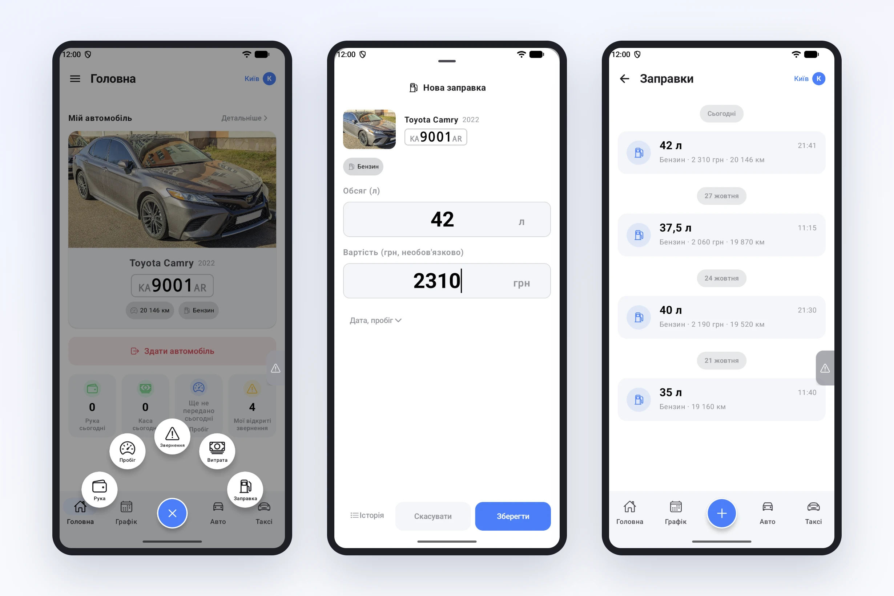

# Заправки — у застосунку водія

Пальне — одна з найбільших статей витрат автопарку, а облік заправок у багатьох парках досі тримається на чеках у бардачку й повідомленнях у месенджері. Хто скільки залив, у яке авто, на якому пробігу — через тиждень це вже не відновити. Тепер водій записує заправку прямо в застосунку, поки стоїть біля колонки.

## Дві дії — і заправка в системі

У меню кнопки «+» з'явилась дія **«Заправка»** — поруч із поїздкою, пробігом, витратою й зверненням. Вона доступна і в простому режимі застосунку, з якого починає більшість водіїв.

Форма мінімальна:

- **Авто** — підставлене: водій записує заправку на автомобіль, на якому він зараз.
- **Тип палива** — береться з картки авто. Якщо авто їздить на одному паливі, вибирати нічого не треба.
- **Обсяг** — скільки літрів залито. Це єдине поле, яке треба заповнити.
- **Вартість** — за бажанням. Водій часто знає лише літри — заправка все одно запишеться.

Пробіг і дата підставляються автоматично: поточний пробіг авто й момент запису. Якщо водій вносить заправку пізніше, ці поля легко розгорнути й поправити.

## Історія — по днях

Усі заправки водія зібрані в розділі **«Заправки»**: за днями, з обсягом, сумою, пробігом і часом. Помилився з цифрою — запис можна виправити або видалити протягом доби.

## Один довідник палива для всієї системи

Разом із заправками ми навели лад у типах палива: бензин, дизель, газ, електро, гібрид — тепер один перелік для всієї системи, від картки авто до регламентів техобслуговування. Тож у застосунку водій бачить саме те паливо, яке вказане для його авто, і не запише дизель у бензинову машину.

## Що це дає парку

- Кожна заправка зберігається в системі — з авто, пробігом, обсягом і датою, а не в чеках і переписці.
- Водієві простіше: кілька секунд біля колонки замість фото чека в чат.
- Дані прив'язані до пробігу — основа для контролю витрати пального по кожному авто.
