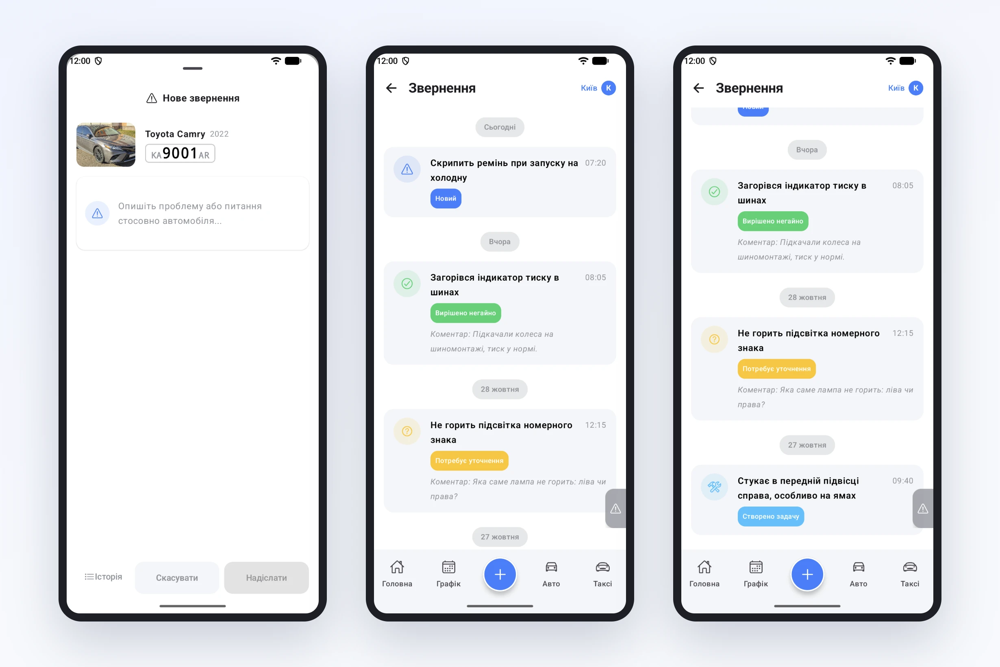
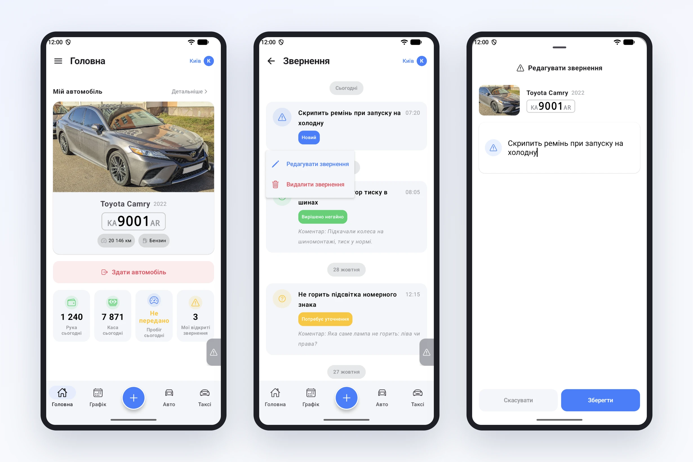

# Помітив несправність, повідомив за хвилину

Про дрібну несправність водії часто мовчать. Дзвонити механіку через скрипучий ремінь незручно, а до кінця зміни вже забулось. Через тиждень дрібниця стає ремонтом. Тому в застосунку повідомити про проблему з авто так само просто, як записати поїздку.

## Написати

Кнопка «+», далі «Звернення». Авто вже вибране, лишається коротко описати, що сталось: «стукає в передній підвісці справа, особливо на ямах». Зберегти, і звернення вже в парку. Без інтернету теж працює: звернення відправиться саме, коли з'явиться зв'язок.

## Бачити, що далі

Усі звернення по своєму авто водій бачить у списку, по днях. Колір і підпис показують, що з ним зараз:

- нове, парк його ще не розглянув;
- потребує уточнення, і поруч питання від парку, наприклад «яка саме лампа не горить: ліва чи права?»;
- створено задачу, тобто авто вже записали на ремонт;
- вирішено одразу, з коментарем, що зробили;
- відхилено, теж з поясненням.

Так водію не треба дзвонити й питати, чи хтось побачив його повідомлення. А на головній плитка «Мої відкриті звернення» показує, скільки звернень по його авто ще не закрито.

## Виправити, поки не взялись

Поки звернення нове, водій може його виправити або видалити протягом 12 годин: натиснути на картку й обрати дію. Щойно парк почав його опрацьовувати, звернення закривається для змін, щоб опис не змінився під час ремонту.

Для парку кожне звернення з'являється в кабінеті разом з авто, водієм і часом. Звідти його можна відхилити, попросити уточнення або одразу створити задачу на ремонт.
