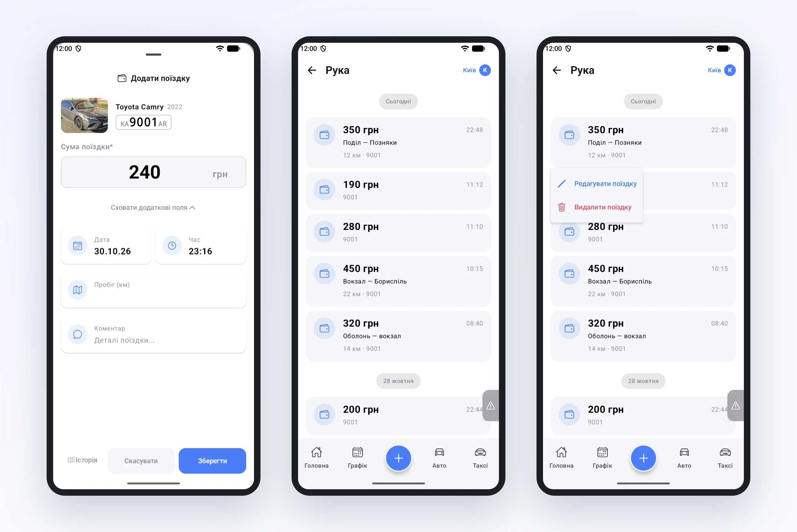
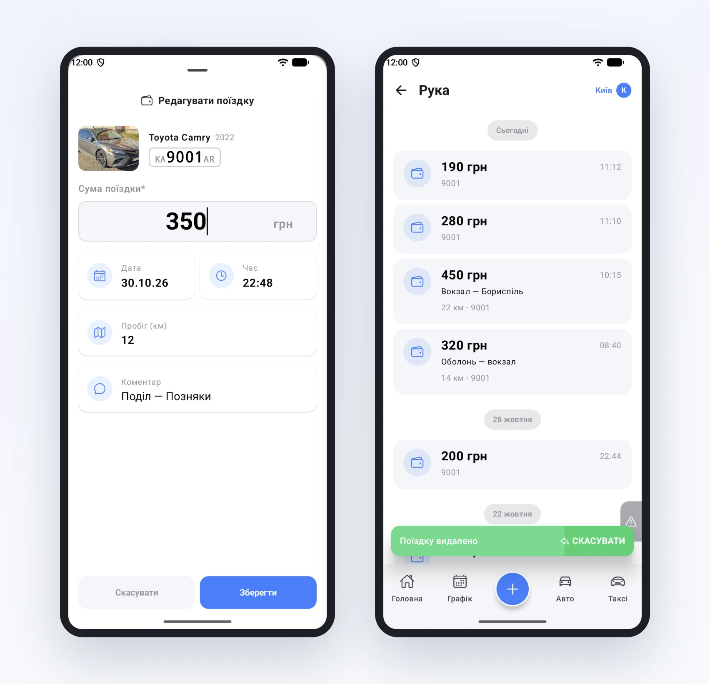

# «Рука» без паперу

«Рукою» в парках називають поїздку, за яку пасажир заплатив водію напряму, повз Uklon. Раніше такі поїздки водії записували в блокнот, у чат або взагалі згадували в кінці тижня. Звідси вічні суперечки на розрахунку: «я ж возив у вівторок».

У застосунку записати руку можна одразу після поїздки.

## Записати

Кнопка «+», далі «Рука». Форма вже знає авто водія, лишається ввести суму і натиснути «Зберегти». Якщо треба, під «Додатково» є дата й час (на випадок, якщо водій записує поїздку пізніше, але не давніше двох днів), пробіг у кілометрах і коментар, наприклад маршрут.

Поїздки видно в історії, згруповані по днях: сума, час, маршрут і кілометри.

## Виправити або видалити

Якщо водій помилився в сумі, він натискає на поїздку, обирає «Редагувати поїздку» і виправляє. Форма та сама, що при записі, тільки всі поля вже відкриті.

Якщо записав двічі, обирає «Видалити поїздку». Внизу з'явиться «Поїздку видалено» з кнопкою «Скасувати»: кілька секунд, щоб передумати, перш ніж зміна піде в парк.

Правити й видаляти поїздку водій може протягом 12 годин після неї. Далі запис уже закритий, і виправити його може тільки менеджер у кабінеті. Так розрахунок за минулі дні не «пливе».

## А що в парку

Кожна рука одразу з'являється в кабінеті, на сторінці ручних поїздок, і потрапляє в заробіток водія. Для розрахунку вона рахується як готівка, яку водій уже тримає в руках.

Без інтернету все працює так само: запис збережеться в телефоні й відправиться сам, щойно з'явиться зв'язок. А хто звик писати в Telegram, може й далі записувати руку одним повідомленням боту парку.
