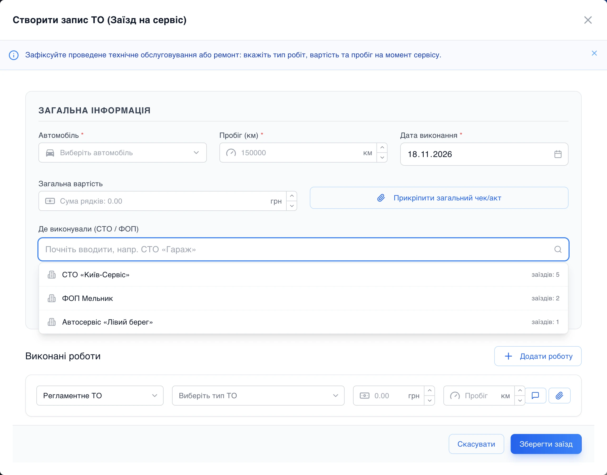
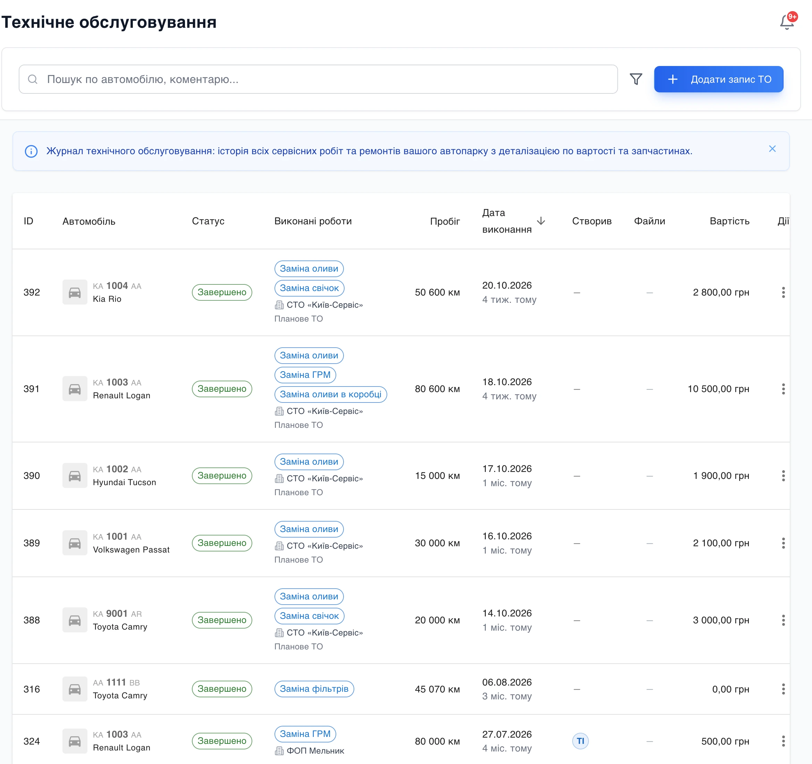
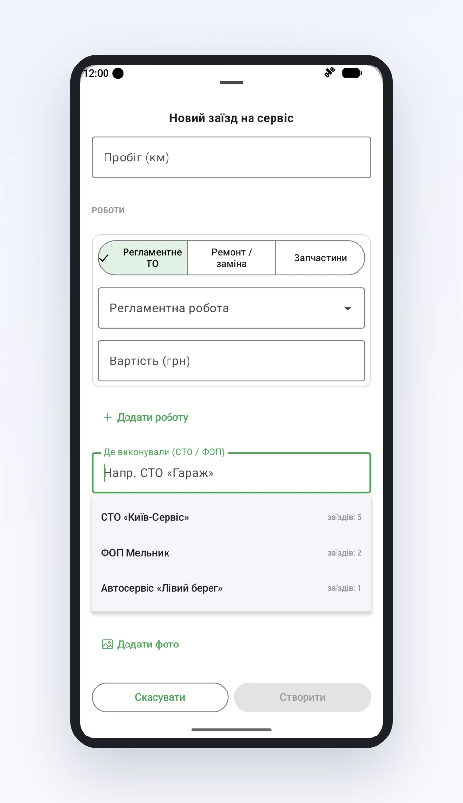

# Де ремонтували авто: СТО у заїзді на сервіс

Якщо відкрити заїзди на сервіс у кількох парках, у коментарях знайдеться одне й те саме: «ФОП Мельник», «у Мельника», «СТО Гараж, Лівий берег». Менеджери пишуть туди, куди відвезли машину, бо окремого місця для цього не було. Згодом прочитати це можна, а от порахувати, скільки за місяць залишили в одного майстра, вже ні. Для цього довелося б гортати кожен заїзд.

Тепер у заїзду є поле «Де виконували (СТО / ФОП)».

## Пишете перші літери, решту пропонує кабінет

Поставте курсор у порожнє поле, і кабінет покаже СТО, до яких ваш парк їздить найчастіше. Біля кожного видно, скільки було заїздів. Почали вводити «мел», і в списку лишиться ФОП Мельник. Обрали його і зберегли заїзд.

Якщо майстер новий, просто введіть назву. Внизу списку буде пункт «Додати нове СТО / постачальника», а сама назва збережеться разом із заїздом. Окремо заводити довідник не треба, він наповнюється по ходу роботи.

Ми подбали, щоб один майстер не роздвоювався. «ФОП Мельник», «фоп мельник» і «ФОП  Мельник» з двома пробілами для системи одна назва. Поле необов'язкове: якщо авто ремонтували своїми силами, залиште його порожнім.

## Потім цим можна користуватися

Назву СТО видно в списку «Обслуговування авто» одразу під роботами, і в деталях заїзду. У фільтрах з'явився пункт «Де виконували»: обираєте майстра і бачите всі машини, які в нього були, разом із сумами. Звичайний пошук теж знаходить заїзди за назвою СТО.

Те саме поле є в застосунку, у розділі ремонту для персоналу. Механік чи менеджер оформлює заїзд просто біля машини, а підказки там ті самі, що й у кабінеті.

## І одна зміна в назві

Заодно ми перейменували вид робіт «Ремонт» на «Ремонт / заміна». Парки пояснили, що частіше міняють те, що зносилось: ремінь, колодки, амортизатори. Нічого не зламалось, а в записі стояло «Ремонт». Старі записи нікуди не ділись, змінилась лише назва.
