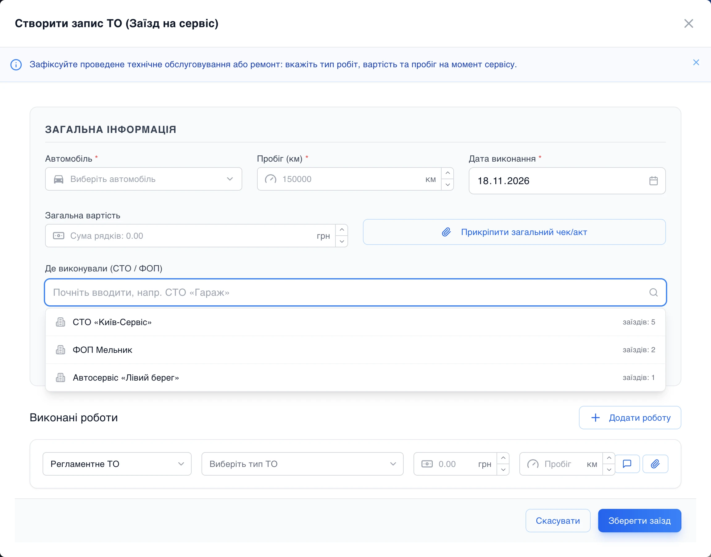
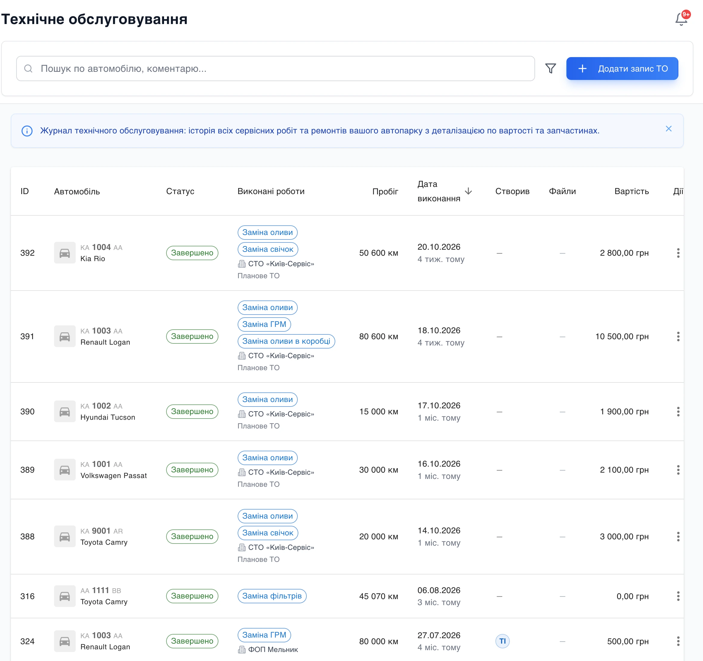
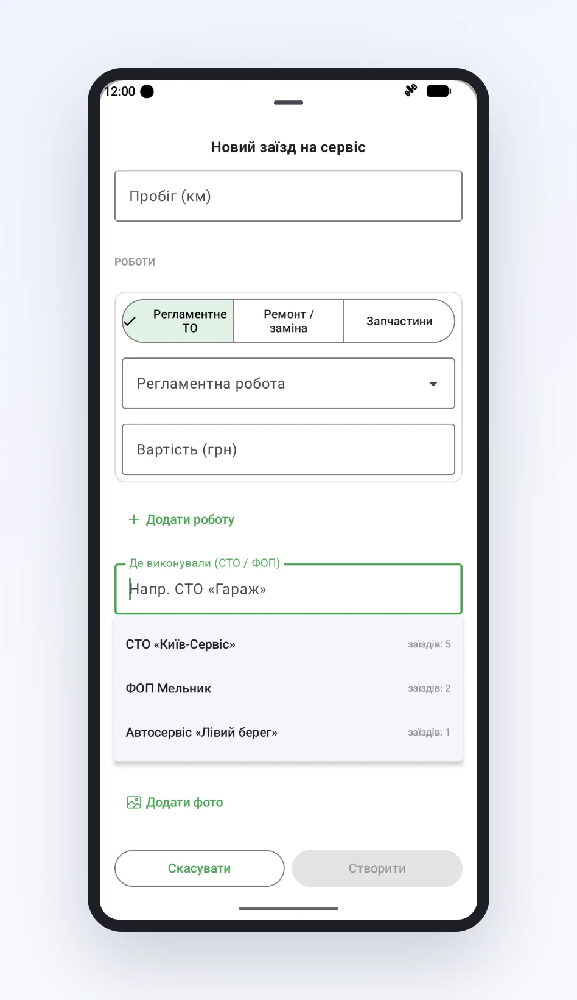

# Where the car was repaired: the garage in a service visit

Open the service visits of almost any fleet and the comments say the same kind of thing: "Melnyk sole trader", "at Melnyk's", "Garazh, left bank". Managers write down where the car went because there was nowhere else to put it. You can read it later, but you can't add up how much went to one mechanic last month without opening every visit.

Service visits now have a field "Where it was done (garage / sole trader)".

## Type a few letters, the dashboard does the rest

Click into the empty field and the dashboard lists the garages your fleet uses most, each with the number of visits. Type "mel" and only Melnyk is left. Pick it and save the visit.

If the mechanic is new, just type the name. At the bottom of the list there is "Add a new garage / supplier", and the name is saved together with the visit. There is no separate list to set up, it fills itself as you work.

We made sure one mechanic doesn't turn into two. "Melnyk", "melnyk" and "Melnyk" with a double space are the same name for the system. The field is optional: if you fixed the car yourselves, leave it empty.

## What you get later

The garage name shows up in the "Vehicle maintenance" list right under the works, and in the visit details. The filters have a new "Where it was done" option: pick a mechanic and see every car that went there, with the amounts. The regular search finds visits by garage name too.

The same field is in the app, in the staff repairs section. A mechanic or manager can log the visit right next to the car, with the same suggestions as in the dashboard.

## One more change: a name

We also renamed the work type "Repair" to "Repair / replacement". Fleets told us that most of the time they replace something that wore out: a belt, brake pads, shock absorbers. Nothing broke, yet the record said "Repair". Old records are all still there, only the name changed.
