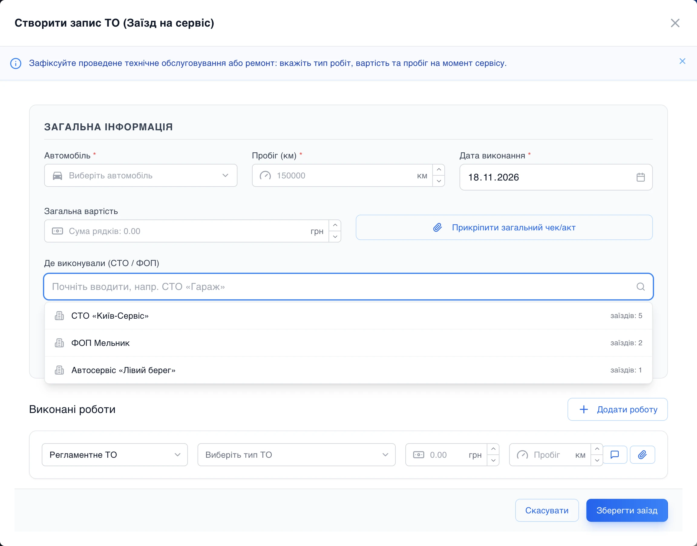
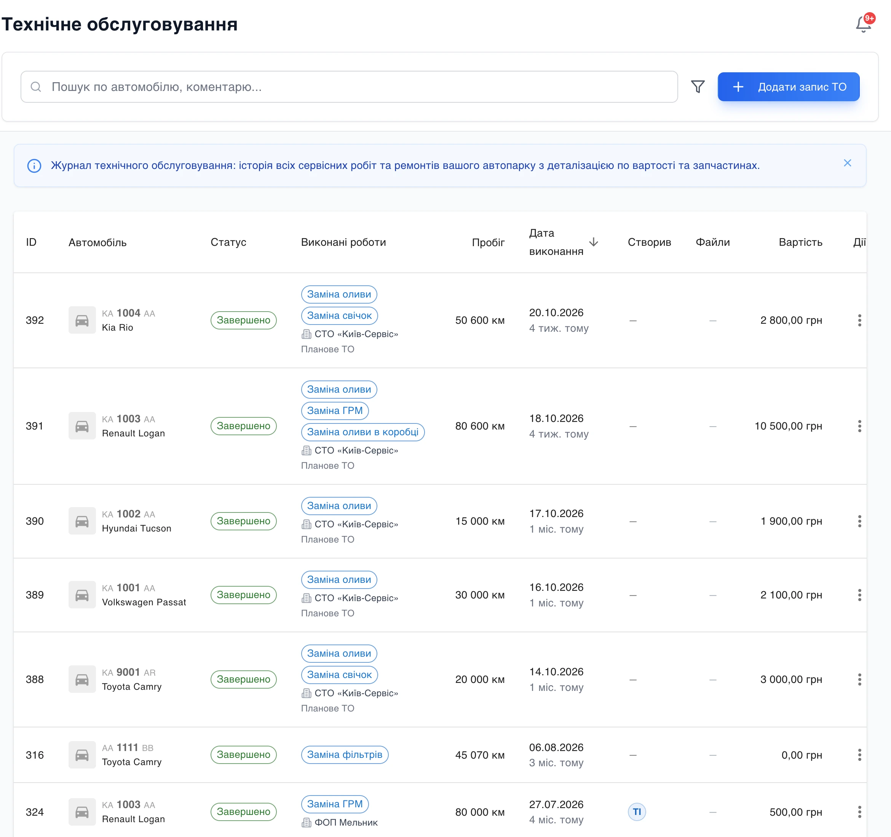
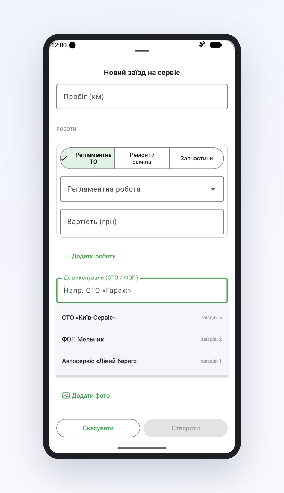

# Где ремонтировали авто: СТО в заезде на сервис

Если открыть заезды на сервис в нескольких парках, в комментариях найдётся одно и то же: «ФОП Мельник», «у Мельника», «СТО Гараж, Левый берег». Менеджеры пишут туда, куда отвезли машину, потому что отдельного места для этого не было. Потом это можно прочитать, а вот посчитать, сколько за месяц оставили у одного мастера, уже нет. Для этого пришлось бы листать каждый заезд.

Теперь у заезда есть поле «Где выполняли (СТО / ФОП)».

## Пишете первые буквы, остальное предлагает кабинет

Поставьте курсор в пустое поле, и кабинет покажет СТО, к которым ваш парк ездит чаще всего. Возле каждого видно, сколько было заездов. Начали вводить «мел», и в списке останется ФОП Мельник. Выбрали его и сохранили заезд.

Если мастер новый, просто введите название. Внизу списка будет пункт «Добавить новое СТО / поставщика», а само название сохранится вместе с заездом. Отдельно заводить справочник не нужно, он наполняется по ходу работы.

Мы позаботились, чтобы один мастер не раздваивался. «ФОП Мельник», «фоп мельник» и «ФОП  Мельник» с двумя пробелами для системы одно название. Поле необязательное: если авто ремонтировали своими силами, оставьте его пустым.

## Что это даёт потом

Название СТО видно в списке «Обслуживание авто» сразу под работами и в деталях заезда. В фильтрах появился пункт «Где выполняли»: выбираете мастера и видите все машины, которые у него были, вместе с суммами. Обычный поиск тоже находит заезды по названию СТО.

То же поле есть в приложении, в разделе ремонта для персонала. Механик или менеджер оформляет заезд прямо возле машины, а подсказки там те же, что и в кабинете.

## И одна смена названия

Заодно мы переименовали вид работ «Ремонт» в «Ремонт / замена». Парки объяснили, что чаще меняют то, что износилось: ремень, колодки, амортизаторы. Ничего не сломалось, а в записи стояло «Ремонт». Старые записи никуда не делись, поменялось только название.
