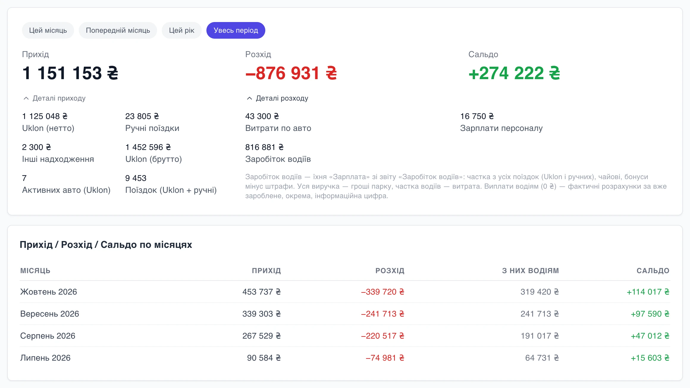
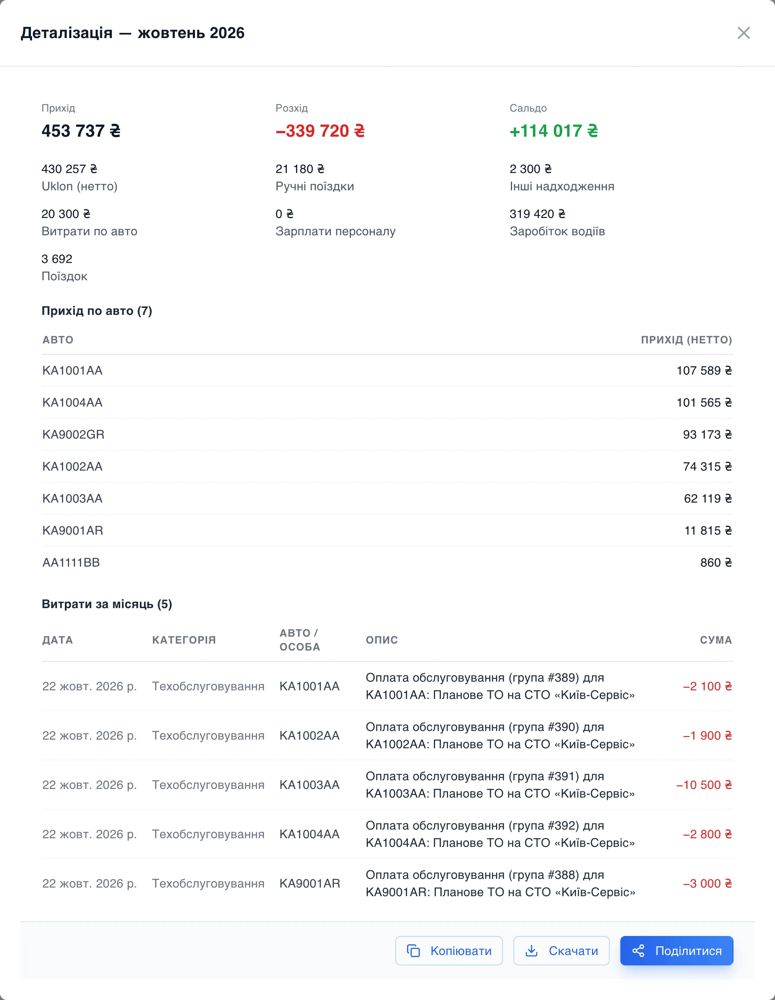

# Економіка парку: головне великими цифрами

Власник парку зазвичай заходить у фінанси з одним питанням: ми в плюсі чи ні? Раніше відповідь доводилось збирати з кількох карток. Uklon окремо, ручні поїздки окремо, витрати ще десь. Ми переробили сторінку **Економіка парку** так, щоб відповідь була на першому екрані.

## Три цифри нагорі

Прихід, розхід і сальдо тепер великими цифрами. У нашому тестовому парку за весь час це 1 151 153 ₴ приходу, 876 931 ₴ розходу і +274 222 ₴ сальдо. Під цифрами перемикач періоду: цей місяць, попередній, цей рік або весь час.

Якщо цікаво, з чого складається сума, натисніть «Деталі приходу» або «Деталі розходу». У приході побачите Uklon уже без комісії, ручні поїздки, інші надходження і бонуси брендування Uklon. У розході витрати по авто, зарплати персоналу і заробіток водіїв.

## Місяць за місяцем

Під цифрами таблиця по місяцях. Окрема колонка «З них водіям» показує, яку частину розходу заробили водії. Ця сума рахується так само, як у звіті «Заробіток водіїв»: частка з усіх поїздок, чайові, бонуси мінус штрафи. Тому дві сторінки показують одне й те саме число, і сперечатися немає з чим.

## Клік по місяцю

Натисніть на місяць, і відкриється розбивка саме за нього. Для жовтня в тестовому парку це 453 737 ₴ приходу і +114 017 ₴ сальдо. Там же прихід кожного авто окремо, від найприбутковішого до того, що майже стояло, і список усіх витрат місяця з датою, авто й описом.

Розбивку можна скопіювати текстом, скачати файлом або переслати партнеру кнопкою «Поділитися».

## Що ще на сторінці

Нижче застави водіїв: скільки зараз у заставі і скільки повернули. Це гроші водіїв, тому в прихід вони не йдуть. І витрати по категоріях за весь час, щоб було видно, куди насправді йдуть гроші: на сервіс, зарплати чи документи.

Вводити нічого окремо не треба. Поїздки Uklon парк підтягує сам, ручні поїздки водії записують у застосунку, а витрати й зарплати беруться з розділу «Фінанси».
