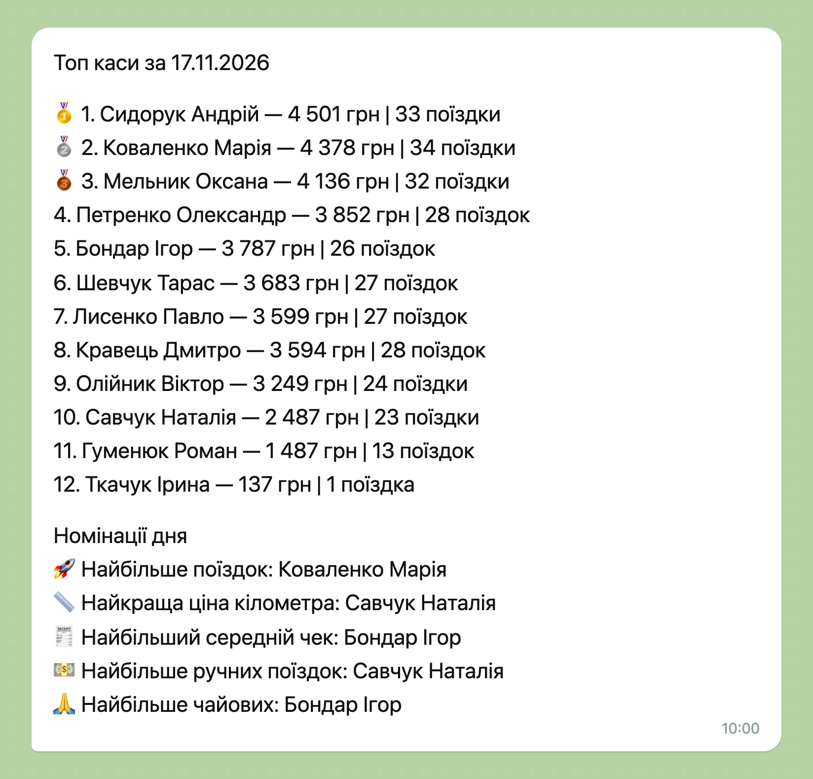

# «Топ каси»: рейтинг, який хочеться переслати в групу

Вранці менеджер парку відкриває Telegram, а там уже чекає вчорашній рейтинг водіїв. Ще у вересні ми зробили «Топ каси» для персоналу, і парки швидко знайшли йому друге життя: почали пересилати рейтинг у групу водіїв. Тільки текст для цього доводилось правити вручну. Тепер звіт одразу приходить у тому вигляді, в якому його не соромно показати водіям.

## Що змінилось

Перший рядок тепер дата, за яку рахується рейтинг. Пересланий у групу, він не плутає: всім видно, що це вчорашній день, а не сьогоднішній.

Кожен рядок рейтингу виглядає так: місце, ім'я, каса й кількість поїздок. Перші три місця з медалями. У касу й поїздки входить усе, що водій зробив за добу, і замовлення Uklon, і поїздки «на руку». Каса Uklon рахується після комісії, так само як у звіті «Заробіток водіїв», тож цифри не розходяться з рештою звітів парку.

## Номінації дня

Під рейтингом тепер п'ять номінацій: найбільше поїздок, найкраща ціна кілометра, найбільший середній чек, найбільше ручних поїздок і найбільше чайових. Так у групі відзначають не лише лідера каси. Хтось сьогодні не перший за грошима, зате взяв найвигідніші замовлення або отримав найбільше чайових від пасажирів.

У номінаціях свідомо немає цифр, лише імена. Ми вирішили, що так нікому не буде прикро: переможця видно, а як далеко від нього решта, обговорювати в групі не обов'язково. Ціна кілометра й середній чек рахуються лише серед водіїв, які зробили хоча б 10 поїздок, щоб номінацію не забирала одна випадкова дорога поїздка. Якщо результат однаковий у кількох водіїв, у номінації будуть усі.

## Як отримувати

Рейтинг приходить щодня о 10:00 від бота вашого парку в особисті повідомлення. Щоб його отримувати:

1. У кабінеті відкрийте Профіль → Telegram і підключіть Telegram за посиланням або QR-кодом.
2. На вкладці «Розсилки» біля «Топ каси» увімкніть Telegram.
3. Натисніть «Надіслати зараз», щоб одразу побачити рейтинг за вчора.

Якщо ваш Telegram уже був прив'язаний до іншого акаунта, наприклад тестового, бот запропонує перенести його на цей акаунт однією кнопкою. Далі лишається переглянути рейтинг і переслати його в групу водіїв.
