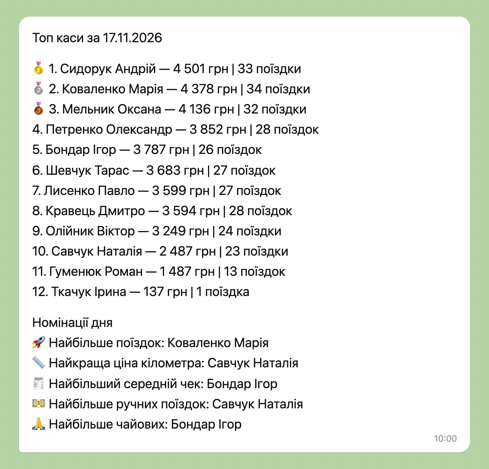

# "Top cash": a ranking you'll want to forward to the group

In the morning a fleet manager opens Telegram, and yesterday's driver ranking is already waiting. We built "Top cash" for fleet staff back in September, and fleets quickly found it a second life: they started forwarding the ranking to the drivers' group. The text had to be edited by hand first, though. Now the report arrives ready to be shown to drivers as it is.

The report itself is in Ukrainian: the bot sends it the same way to every fleet.

## What changed

The first line is now the date the ranking is for. Once forwarded to the group, it can't be mistaken: everyone sees it's yesterday, not today.

Each ranking line shows the place, the name, the cash and the number of trips. The top three get medals. Cash and trips include everything the driver did that day, both Uklon orders and cash-in-hand trips. Uklon cash is counted after the Uklon commission, just like in the "Driver earnings" report, so the numbers match the rest of the fleet's reports.

## Nominations of the day

Below the ranking there are now five nominations: most trips, best price per kilometer, highest average fare, most cash-in-hand trips and most tips. This way the group celebrates more than the cash leader. Someone may not be first by money today but took the most profitable orders or got the most tips from passengers.

The nominations deliberately have no numbers, only names. We decided this way nobody gets upset: the winner is visible, and how far behind the others are doesn't need to be discussed in the group. Price per kilometer and average fare only count drivers with at least 10 trips, so a single lucky expensive ride can't take the nomination. If several drivers have the same result, all of them are named.

## How to get it

The ranking arrives every day at 10:00 from your fleet's bot as a private message. To get it:

1. In the dashboard, open Profile → Telegram and connect Telegram using the link or the QR code.
2. On the "Mailings" tab, turn on Telegram next to "Top cash".
3. Press "Send now" to see yesterday's ranking right away.

If your Telegram was already linked to another account, a test one for example, the bot offers to move it to this account with one button. Then just review the ranking and forward it to the drivers' group.
