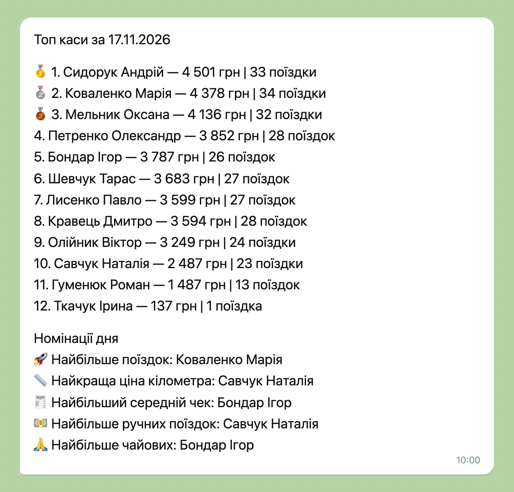

# «Топ кассы»: рейтинг, который хочется переслать в группу

Утром менеджер парка открывает Telegram, а там уже ждёт вчерашний рейтинг водителей. Ещё в сентябре мы сделали «Топ кассы» для персонала, и парки быстро нашли ему вторую жизнь: начали пересылать рейтинг в группу водителей. Только текст для этого приходилось править вручную. Теперь отчёт сразу приходит в том виде, в котором его не стыдно показать водителям.

Сам отчёт приходит на украинском: бот присылает его одинаково всем паркам.

## Что изменилось

Первая строка теперь дата, за которую считается рейтинг. Пересланный в группу, он не путает: всем видно, что это вчерашний день, а не сегодняшний.

Каждая строка рейтинга выглядит так: место, имя, касса и количество поездок. Первые три места с медалями. В кассу и поездки входит всё, что водитель сделал за сутки, и заказы Uklon, и поездки «на руку». Касса Uklon считается после комиссии, так же как в отчёте «Заработок водителей», поэтому цифры не расходятся с остальными отчётами парка.

## Номинации дня

Под рейтингом теперь пять номинаций: больше всего поездок, лучшая цена километра, самый большой средний чек, больше всего ручных поездок и больше всего чаевых. Так в группе отмечают не только лидера кассы. Кто-то сегодня не первый по деньгам, зато взял самые выгодные заказы или получил больше всего чаевых от пассажиров.

В номинациях сознательно нет цифр, только имена. Мы решили, что так никому не будет обидно: победителя видно, а насколько от него отстают остальные, обсуждать в группе не обязательно. Цена километра и средний чек считаются только среди водителей, сделавших хотя бы 10 поездок, чтобы номинацию не забирала одна случайная дорогая поездка. Если результат одинаковый у нескольких водителей, в номинации будут все.

## Как получать

Рейтинг приходит каждый день в 10:00 от бота вашего парка в личные сообщения. Чтобы его получать:

1. В кабинете откройте Профиль → Telegram и подключите Telegram по ссылке или QR-коду.
2. На вкладке «Рассылки» рядом с «Топ кассы» включите Telegram.
3. Нажмите «Отправить сейчас», чтобы сразу увидеть рейтинг за вчера.

Если ваш Telegram уже был привязан к другому аккаунту, например тестовому, бот предложит перенести его на этот аккаунт одной кнопкой. Дальше остаётся просмотреть рейтинг и переслать его в группу водителей.
