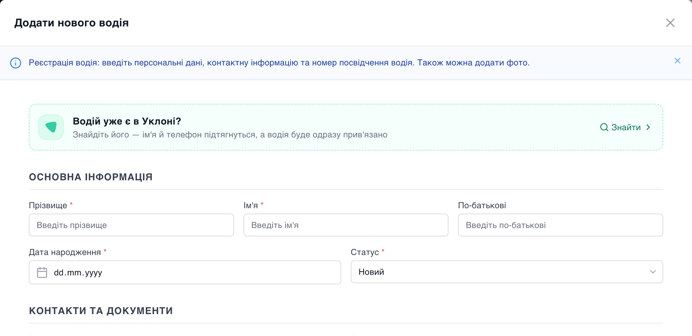
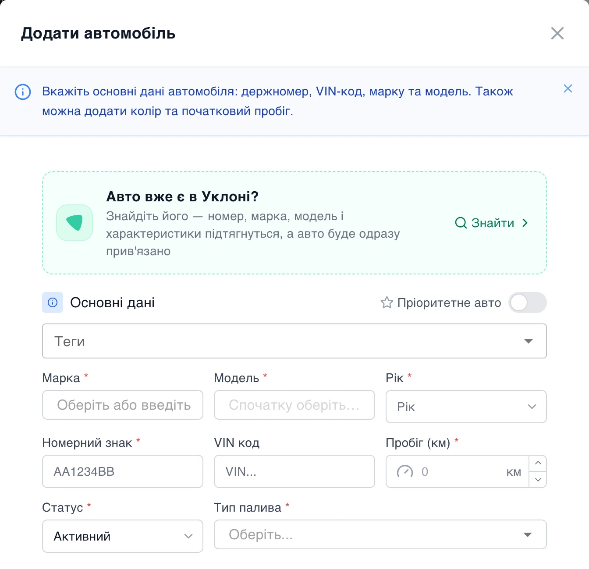
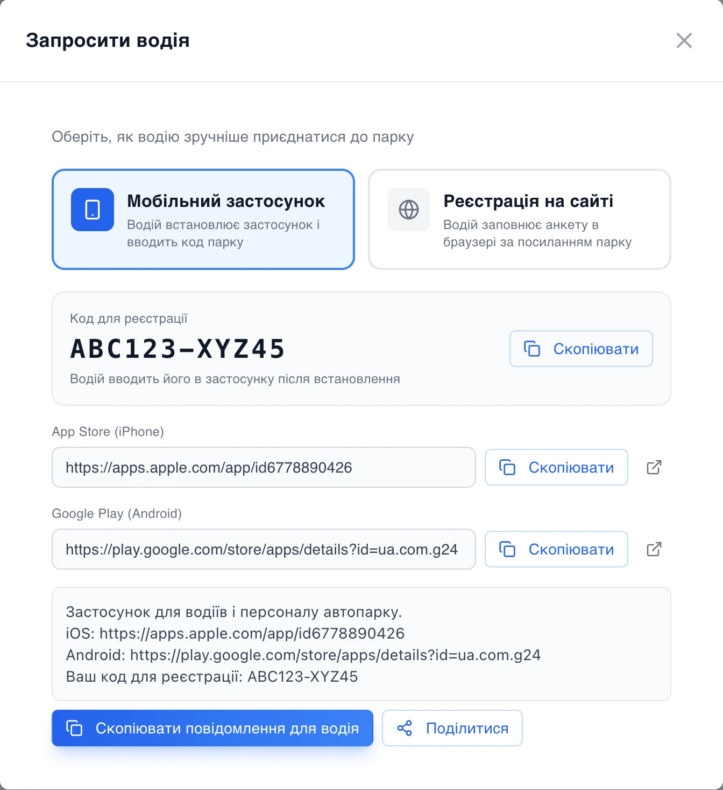

# Водій чи авто з Уклону — у парку за хвилину

Типова ситуація: водій уже їздить у вашому флоті Уклону, авто теж там зареєстроване, а в системі їх ще немає. Раніше доводилося створювати водія вручну — переписувати ПІБ і телефон — і лише потім прив'язувати його до Уклону. Тепер це один крок.

## «Знайти в Уклоні» — прямо у формі

У формах **«Додати водія»** і **«Додати автомобіль»** з'явився блок **«Вже є в Уклоні?»** з кнопкою **«Знайти»**.

Натискаєте — система оновлює дані вашого флоту з Уклону й показує тих водіїв і авто, яких ще немає в системі. Шукати можна за ПІБ, телефоном, номером, маркою чи моделлю. Вибрали потрібного — і форма заповнюється сама:

- **для водія** — прізвище, ім'я, по батькові й телефон;
- **для авто** — номер, марка, модель, рік, колір, кузов, клас, кількість місць і опції.

Решту, чого в Уклоні немає (посвідчення, дата народження, пробіг, паливо), додаєте як завжди. Після збереження водій чи авто **одразу прив'язані до Уклону** — разом з історією замовлень.

## Без дублів

Якщо такий водій (за телефоном) чи авто (за номером) уже є в системі, форма попередить і запропонує прив'язати наявний запис замість створення ще одного. Тож одна людина — одна картка, одне авто — одна картка.

## «Запросити водія» — однією кнопкою

На сторінці водіїв кнопка «Посилання для реєстрації» стала кнопкою **«Запросити водія»**. Вона відкриває діалог з вибором, як водієві зручніше приєднатися:

- **Мобільний застосунок** — водій встановлює застосунок і вводить код парку. Діалог показує код, посилання на App Store і Google Play та готове повідомлення для водія.
- **Реєстрація на сайті** — водій заповнює анкету в браузері за посиланням парку.

Повідомлення копіюється однією кнопкою — лишається вставити його в месенджер. А в браузерах, які це підтримують, можна одразу натиснути «Поділитися».

## Що це дає парку

- Новий водій чи авто з Уклону — у системі за хвилину, без ручного переписування даних.
- Прив'язка до Уклону й історія замовлень — одразу, а не «потім, коли дійдуть руки».
- Жодних дублів водіїв і авто.
- Запрошення в застосунок — готовим повідомленням, без пошуку посилань і кодів.

Пошук в Уклоні працює для парків з підключеною інтеграцією Уклону.
