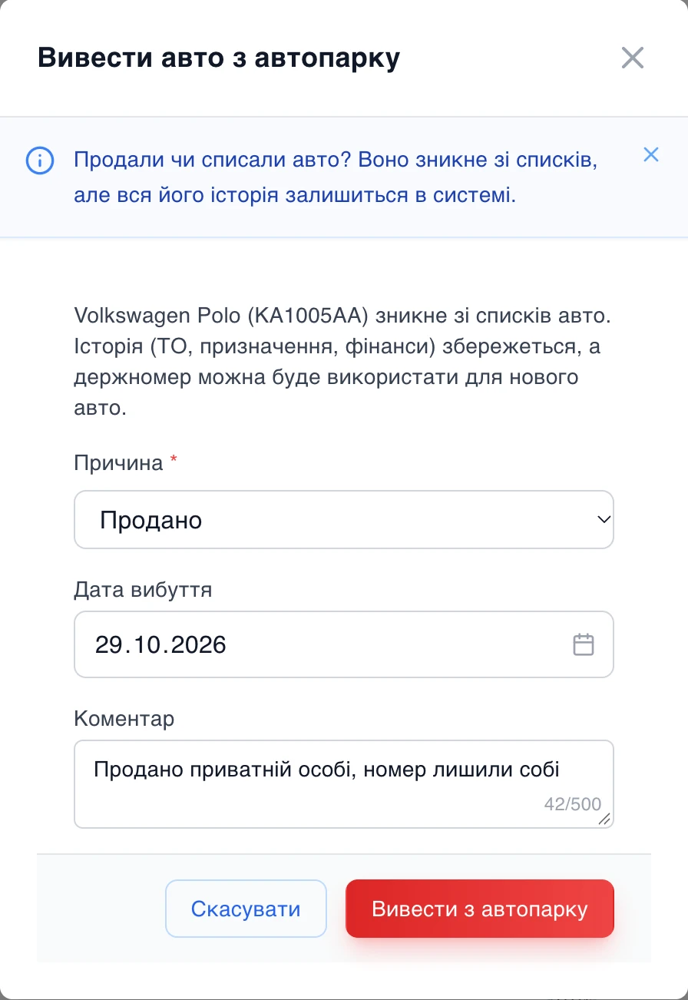
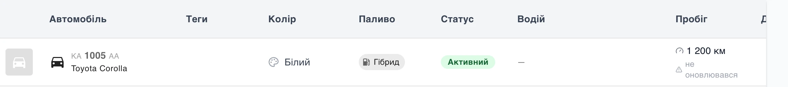

# Продали авто — історія лишилась

Реальна ситуація з парку: старе авто продали, купили нове, а держномер, як дозволяє законодавство, залишили собі. Раніше система до цього була не готова. Номер мав бути унікальним, тож нове авто з ним не додавалось, поки в парку значилось старе. А якщо старе авто видаляли, разом з ним зникала вся його історія: техобслуговування, страховки, призначення водіїв, пробіг, задачі.

## «Вивести з автопарку» замість «Видалити»

Тепер продаж чи списання — окрема дія **«Вивести з автопарку»**. Вона є в меню авто в списку, у картці авто й у мобільній версії кабінету.

У вікні вказуєте:

- **причину** — продано, списано чи інше;
- **дату вибуття** — можна минулу, якщо оформлюєте заднім числом;
- **коментар** за бажанням — наприклад, кому продано авто.

Вікно одразу пояснює, що станеться: авто зникне зі списків, а історія збережеться.

## Історія — на місці

Виведене авто зникає зі списків, пошуку, Telegram-бота й застосунку водія, але не з бази. ТО, страховки, призначення, пробіг і фінанси лишаються — їх можна переглядати й фільтрувати, як і раніше.

Фінансові звіти — транзакції, «Економіка парку», «Заробіток авто», виплати — завжди бачать, за яке авто платили, навіть якщо його вже продано. А замовлення Uklon розподіляються за датою поїздки: усе до дати вибуття лишається за старим авто, після — за новим.

## Той самий номер — новому авто

Держномер, VIN і прив'язка до Uklon тепер унікальні лише серед авто, які справді є в парку. Тож нове авто з номером проданого додається одразу, без звернень у підтримку.

## Порядок у дрібницях

- Авто, на якому зараз працює водій, вивести не можна — спершу його треба здати.
- Майбутні зміни в графіку на виведене авто видаляються автоматично, відпрацьовані лишаються в історії.
- До виведеного авто вже не прив'язати нових записів — задач, ТО, поїздок, боргів — навіть з вікна, відкритого до продажу.
- З дати вибуття авто не рахується в білінгу парку.

## А якщо змінили номер?

Номер авто можна змінити в його картці — і тепер старий номер не зникає безслідно. Кожна зміна записується в журнал дій: який був номер, який став, хто й коли змінив.
