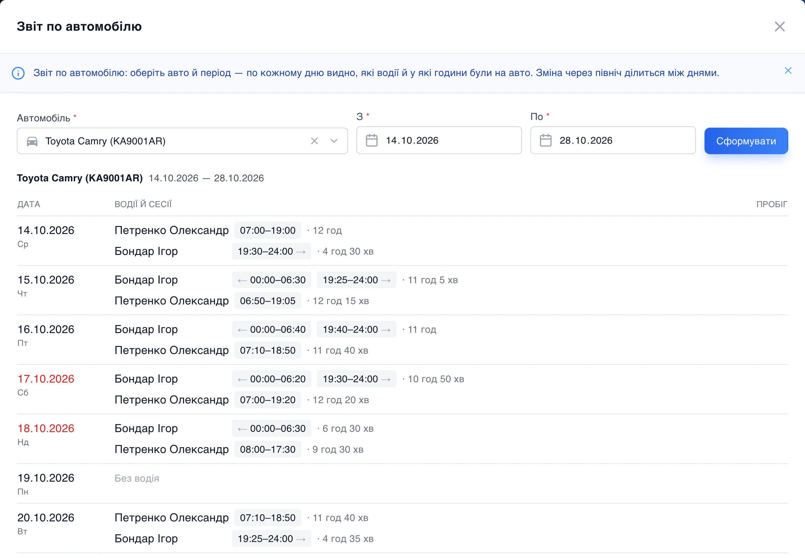
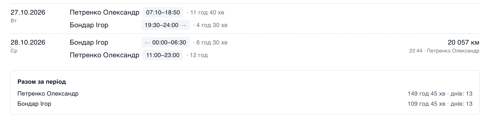

# Хто й коли їздив на авто

Прийшов штраф з камери: четвер, 3:40 ночі. На цій Camry працюють двоє, один удень, другий уночі. Хто з них був за кермом? Раніше менеджер гортав журнал призначень запис за записом і рахував години в голові. Тепер для цього є звіт.

На сторінці **Водії → Призначення** з'явилась кнопка «Звіт». Обираєте авто й період, і кожен день стає окремим рядком: хто з водіїв був на машині, з котрої до котрої і скільки годин набралось.

## Нічні зміни і дні простою

Нічна зміна в звіті ділиться на два дні. Водій прийняв авто о 19:30 і здав о 6:30? У середу буде 19:30-24:00, у четвер 00:00-6:30, а стрілочки показують, що це одна зміна. Тож відповідь про штраф о 3:40 у четвер шукайте в рядку четверга.

Дні, коли машина стояла без водія, теж у списку з позначкою «Без водія». У нашому прикладі це понеділки.

Незавершена зміна рахується до поточної хвилини. А в ніч переходу на зимовий час звіт пам'ятає, що в добі було 25 годин.

## Пробіг і підсумок

Праворуч у кожному дні останній показ пробігу, якщо водій його передав: кілометри, час і хто саме. Унизу підсумок за період, скільки годин і днів кожен провів на авто. За два тижні на нашій Camry це 149 годин у денного водія і 110 у нічного.

Звіт можна зробити й для авто, яке вже продали чи списали, за той час, поки воно було в парку.

## Фото прийому й здачі нікуди не діваються

І ще одна зміна поруч. Фото й відео, які водії надсилають у Telegram при прийомі та здачі авто, тепер зберігаються в архіві парку. У картці призначення відкриваються вже ці файли, а не посилання на Telegram, тож їх можна переглянути і через пів року.
